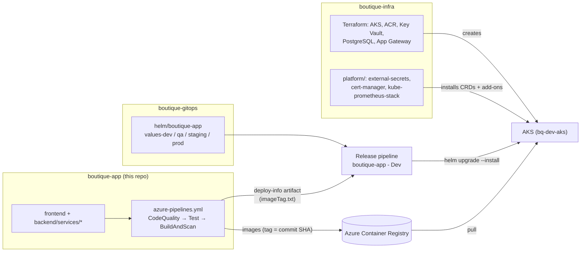
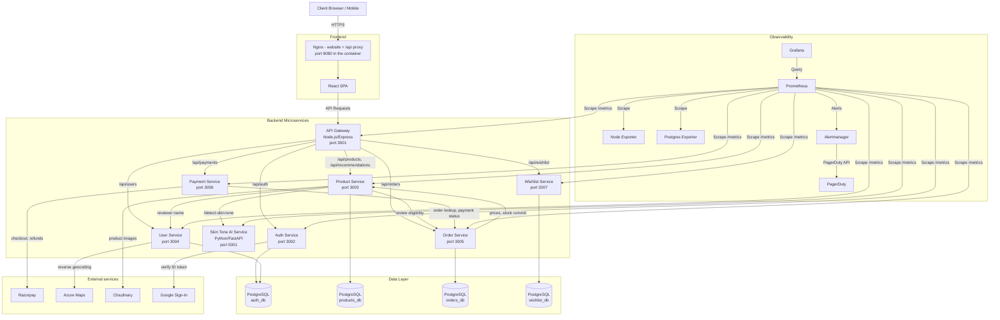
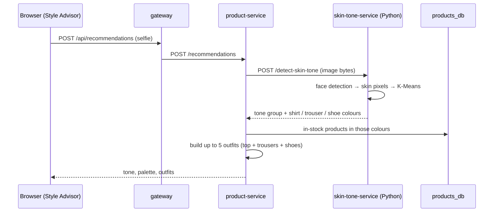
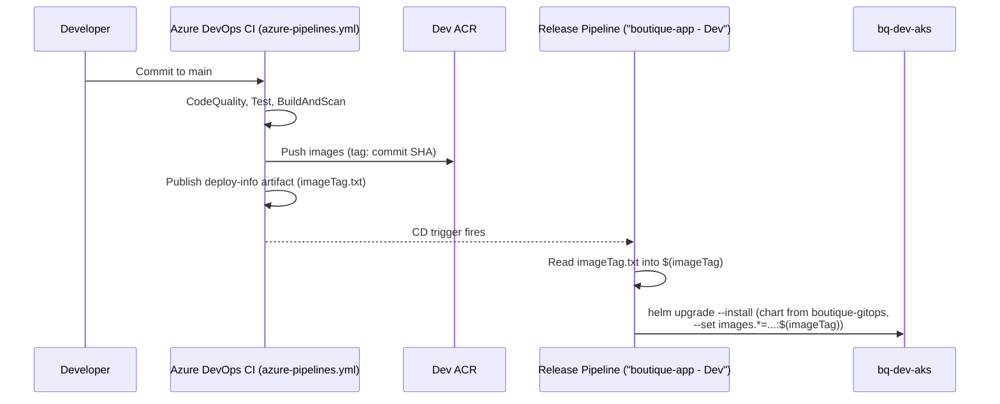
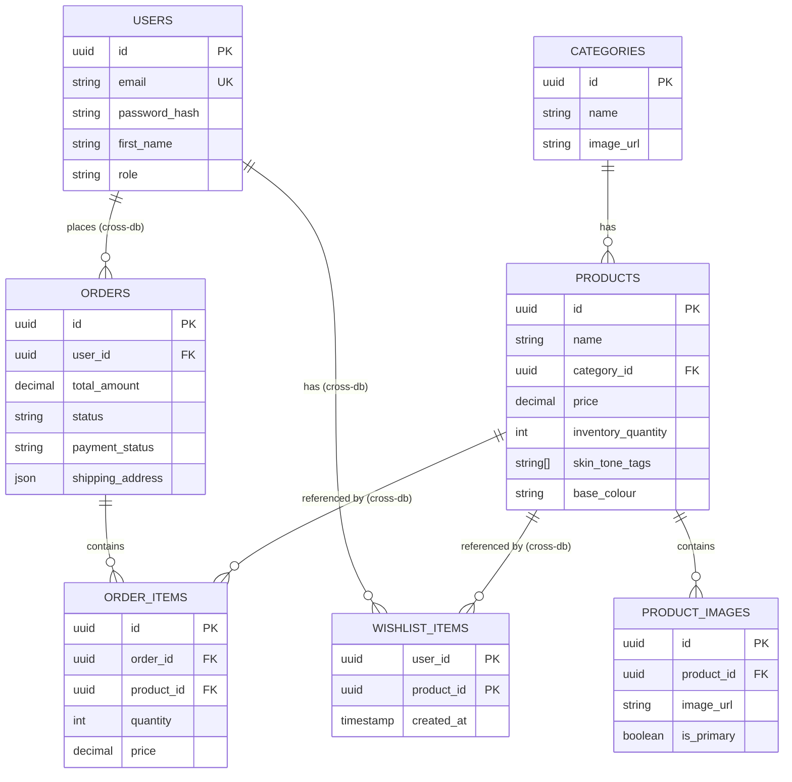

# 🛍️ Boutique Enterprise Microservices App


The **Boutique Microservices App** is an online shop for men's formal wear (shirts, trousers,
shoes, blazers, suits, coats), sold under the **Lux Atelier** brand. It is built as a set of
microservices and runs on **Azure Kubernetes Service (AKS)**. Its standout feature is the
**Style Advisor**: upload a selfie, and a Python computer-vision service detects your skin tone and
recommends colours and complete outfits that are in stock.

This repository holds the **application code**: a React website, seven Node.js/TypeScript services
and one Python service, the database schema and seed data, a Docker Compose setup that runs the
whole system on one machine, the local monitoring configuration, and the CI pipeline that builds
the container images.

> **New here?** Read [How the three repos fit together](#-how-the-three-repos-fit-together), then
> [Quick start](#-quick-start-local) to run everything on your laptop. The per-service READMEs
> under `backend/services/*/README.md` list every route and variable of each service.

---

## 📑 Table of Contents

1. [What's inside and why](#-whats-inside-and-why)
2. [How the three repos fit together](#-how-the-three-repos-fit-together)
3. [Quick start (local)](#-quick-start-local)
4. [Repository layout](#-repository-layout)
5. [Architecture and request flow](#-architecture-and-request-flow)
6. [Services at a glance](#-services-at-a-glance)
7. [System Components & Microservices](#-system-components--microservices)
   - [Frontend Architecture](#frontend-architecture)
   - [API Gateway](#api-gateway)
   - [Backend Microservices](#backend-microservices)
   - [Database Architecture](#database-architecture)
8. [Unique Features](#-unique-features)
   - [AI-Driven Skin Tone Analysis](#ai-driven-skin-tone-analysis)
   - [Invoices](#invoices)
9. [Configuration and environment variables](#-configuration-and-environment-variables)
10. [Local Development Guide](#-local-development-guide)
    - [Prerequisites](#prerequisites)
    - [Environment Setup](#environment-setup)
    - [Running with Docker Compose](#running-with-docker-compose)
    - [Running Services Locally (npm)](#running-services-locally-npm)
    - [Tests](#tests)
11. [Observability & Monitoring](#-observability--monitoring)
    - [Metrics](#metrics)
    - [Prometheus & Alertmanager](#prometheus--alertmanager)
    - [SLO and error budget](#slo-and-error-budget)
    - [Grafana Dashboards](#grafana-dashboards)
12. [CI/CD (Azure DevOps)](#-cicd-azure-devops)
    - [Docker & Containerization](#docker--containerization)
    - [CI pipeline: azure-pipelines.yml](#ci-pipeline-azure-pipelinesyml)
    - [Deployment: Azure DevOps Release Pipelines](#deployment-azure-devops-release-pipelines)
13. [API Documentation Overview](#-api-documentation-overview)
14. [Database Schema](#-database-schema)
15. [Security & Authentication](#-security--authentication)
16. [Common tasks](#-common-tasks)
17. [Troubleshooting](#-troubleshooting)
18. [Known gaps and stale docs](#-known-gaps-and-stale-docs)
19. [Where to go next](#-where-to-go-next)
20. [License & Contributing](#-license--contributing)

---

## 🧭 What's inside and why

**For shoppers**

- Catalogue with categories, search, price filters and sorting; product pages with image galleries
- Cart and checkout with **Razorpay**; order history, cancellations, returns and refunds
- **Style Advisor**: skin-tone detection (OpenCV + K-Means) → colour palette → ready-made outfits
- Sign-in with email/password or Google; wishlist; profile with a saved address that can be filled
  from your current location (**Azure Maps** reverse geocoding)
- Invoice PDF, generated in the browser for paid or refunded orders

**For the business**

- Admin area (`/admin`): orders and fulfilment steps, refunds, customer requests, catalogue,
  stock adjustments and history, customer list, KPIs
- Business KPI dashboard in Grafana (revenue, orders, users)

**Engineering choices, and why**

| Choice | Why |
|---|---|
| **Microservices** (gateway, auth, user, product, orders, payment, wishlist, skin-tone) | Each business area is built, scaled and fails independently |
| **API gateway** in front of the services | One entry point for the browser: routing, CORS allow-list, security headers, metrics |
| **One logical PostgreSQL database per domain** (`auth_db`, `products_db`, `orders_db`, `wishlist_db`) | Services don't read each other's tables; they talk over HTTP |
| **Every service verifies the JWT itself**, plus a shared internal token for service-to-service calls | No service trusts the network or the gateway alone |
| **Prices computed on the server** (orders service) | The browser never sends amounts |
| **Prometheus metrics in every service**, labelled by route template | RED metrics and SLOs per service without unbounded label values |
| **Hardened images** (multi-stage builds, non-root users, explicit `COPY` allowlists) | Smaller images, less attack surface, no stray files or secrets |
| **Three repos: app / chart / infra** | Building code, describing what runs, and creating the cloud are changed and reviewed separately |

---

## 🔗 How the three repos fit together

This is the **Azure** edition of the shop. It is one of three repositories, all in Azure DevOps:

| Repo | What it holds | Who applies it |
|---|---|---|
| **`boutique-app`** (this) | Website + microservices, database schema/seed, local Docker setup, CI pipeline | Azure Pipelines builds images and pushes them to Azure Container Registry |
| `boutique-gitops` | Helm chart for the app (`helm/boutique-app`, `values-<env>.yaml`): deployments, AGIC ingress, External Secrets from Key Vault, network policies, HPA, PrometheusRules and Grafana dashboards | The "boutique-app - Dev" Release pipeline (`helm upgrade --install`) |
| `boutique-infra` | Azure infrastructure (Terraform under `azure/environments/<env>`: AKS, ACR, Key Vault, identities, PostgreSQL, App Gateway, Azure Maps) and the platform add-ons (`platform/`) | Terraform and Helm pipelines (`azure-pipelines-infra.yml`, `-platform.yml`, `-destroy.yml`) |



The same application also runs on AWS as **`luxatelier-app`** (GitLab, EKS, Argo CD). The code is
shared, apart from the cloud integrations: **Azure Maps** here instead of Amazon Location, and
**browser-generated invoices** here instead of S3/SQS/SES email.

---

## 🚀 Quick start (local)

Prerequisites: Docker with Docker Compose, and about 8 GB of free RAM.

```bash
git clone https://luxatelier@dev.azure.com/luxatelier/boutique-app/_git/boutique-app
cd boutique-app
# create .env (see "Environment Setup" below for every variable)
echo "dummy-key" > alertmanager/pagerduty_key.txt   # gitignored; put a real routing key here to page
docker compose up -d --build
docker compose ps          # wait until the services show "healthy"
```

Create `alertmanager/pagerduty_key.txt` **before** the first `up`. If it is missing, Docker creates
an empty directory at that path and Alertmanager won't start.

| Open | What |
|---|---|
| http://localhost:3000 | The shop (admin area: `/admin`) |
| http://localhost:3001/api/products | API through the gateway |
| http://localhost:3008 | Grafana, `admin` / `admin` |
| http://localhost:9090 | Prometheus (targets, rules, alerts) |
| http://localhost:9093 | Alertmanager |
| `localhost:5433` | PostgreSQL (`psql -h localhost -p 5433 -U postgres`) |

Stop it with `docker compose down`; add `-v` to also wipe the local database (it is re-created
and re-seeded on the next `up`).

Sign in to `/admin` with `ADMIN_EMAIL` (default `admin@luxatelier.in`) and the
`ADMIN_INITIAL_PASSWORD` from your `.env`; you'll be asked to set a new password first (see
[Accounts and roles](#accounts-and-roles)).

---

## 🗂 Repository layout

```text
boutique-app/
├── frontend/                  # React 19 + Vite SPA, served by unprivileged nginx on :8080
│   ├── src/                   #   pages/, components/, contexts/, services/ (API clients), utils/
│   ├── nginx.conf             #   SPA routing, /api proxy to the gateway, security headers, HTTP→HTTPS
│   └── vite.config.ts         #   dev server :3000, proxies /api to localhost:3001
├── backend/
│   ├── services/              # one folder per microservice, each with its own README and Dockerfile
│   │   ├── gateway/           #   :3001  single API entry point
│   │   ├── auth/              #   :3002  sign-in, tokens, store admin
│   │   ├── product-service/   #   :3003  catalogue, stock, reviews, Style Advisor
│   │   ├── user-service/      #   :3004  profiles, customers, Azure Maps
│   │   ├── orders/            #   :3005  orders, pricing, fulfilment, refunds
│   │   ├── payment/           #   :3006  Razorpay checkout and refunds
│   │   ├── wishlist-service/  #   :3007  saved items
│   │   └── skin-tone-service/ #   :5001  Python AI: skin tone → colours
│   ├── shared/types.ts        # shared TypeScript types
│   └── package.json           # backend-level scripts (dev/build/test for some services)
├── database/
│   ├── init/                  # 10-create-databases.sh, 20-init-schema.sql, 40-formal-products.sql (seed)
│   └── scripts/grant-admin.sql
├── prometheus/                # prometheus.yml + rules/alerts.yml + rules/recording.yml
├── alertmanager/              # alertmanager.yml (+ gitignored pagerduty_key.txt)
├── grafana/provisioning/      # datasources and six dashboards (JSON)
├── docker-compose.yml         # the whole stack on one machine (15 containers)
├── azure-pipelines.yml        # CI: CodeQuality → Test → BuildAndScan
├── azure/                     # pipeline templates (code quality, test, build/push)
└── package.json               # npm workspaces root and convenience scripts
```

| Service | README |
|---|---|
| gateway | [backend/services/gateway](backend/services/gateway/README.md) |
| auth | [backend/services/auth](backend/services/auth/README.md) |
| product-service | [backend/services/product-service](backend/services/product-service/README.md) |
| user-service | [backend/services/user-service](backend/services/user-service/README.md) |
| orders | [backend/services/orders](backend/services/orders/README.md) |
| payment | [backend/services/payment](backend/services/payment/README.md) |
| wishlist-service | [backend/services/wishlist-service](backend/services/wishlist-service/README.md) |
| skin-tone-service | [backend/services/skin-tone-service](backend/services/skin-tone-service/README.md) |

Each service README lists its routes with the access they need, its environment variables, what it
calls, and how to run its tests.

---

## 🏛 Architecture and request flow

The system follows a typical microservices architecture: a React SPA, an API gateway that routes
browser requests, independent backend services with their own databases, and an observability
stack.



### A browser request, step by step

1. **Edge.** Locally the browser talks to nginx in the `frontend` container (`localhost:3000` →
   container port 8080). In AKS, Azure Application Gateway (AGIC ingress in `boutique-gitops`)
   terminates TLS and routes `/api` to the `gateway` Service and `/` to the frontend.
2. **Website.** nginx serves the built SPA and sends every unknown path to `index.html`, so React
   Router handles client-side routes. It also proxies `/api/` to `gateway:3001`, so the browser
   only ever talks to one origin.
3. **Gateway.** [`gateway/src/index.ts`](backend/services/gateway/src/index.ts) applies `helmet`,
   the CORS allow-list (`CORS_ORIGINS`) and metrics, **deletes any `x-internal-token` header**, and
   proxies by prefix with `http-proxy-middleware`, stripping the prefix
   (`/api/orders/my-orders` → orders `/my-orders`; `/api/wishlist/*` → `/wishlist/*`;
   `/api/recommendations` → product-service `/recommendations`). The gateway does **not** check
   JWTs.
4. **Service.** The target service verifies the `Authorization: Bearer <JWT>` itself
   (`requireUser` / `requireAdmin`), does its work against its own database, and may call other
   services.

### Service-to-service calls

Internal calls go **directly** between services over the container/cluster network, using the
`*_SERVICE_URL` variables, **not through the gateway** (the gateway strips the internal token, so
internal routes can't be reached through it). They carry the header
`x-internal-token: $INTERNAL_API_TOKEN`, checked with a constant-time comparison by
`requireInternal`.

| Caller | Callee | What for |
|---|---|---|
| orders | product-service `GET /:id`, `POST /internal/inventory/commit` | Current price and stock at order time; deduct/return stock on pay, cancel, refund |
| payment | orders `GET /internal/orders/:id`, `PUT /internal/orders/:id/razorpay-order`, `PATCH /:id/payment-status` | Owner and stored total; bind the Razorpay order; mark paid/failed/refunded |
| product-service | orders `GET /internal/orders/:id/review-eligibility` | Only customers with a delivered order may review |
| product-service | user-service `GET /internal/users/:id/display-name` | Reviewer name |
| product-service | skin-tone-service `POST /detect-skin-tone` | Style Advisor (no token; the Python service is internal only) |

---

## 📋 Services at a glance

| Service | Port | Stack | Database | Calls | Service-specific env vars | Unit tests |
|---|---|---|---|---|---|---|
| `frontend` | 8080 in container (3000 on host) | React 19, Vite, MUI 7, nginx | — | gateway via `/api` | `VITE_API_URL`, `VITE_GOOGLE_CLIENT_ID` (build time) | Vitest (`src/utils/*.test.ts`) |
| `gateway` | 3001 | Express, `http-proxy-middleware` | — | all services | `CORS_ORIGINS`, `AUTH_SERVICE_URL`, `USER_SERVICE_URL`, `PRODUCTS_SERVICE_URL`, `ORDERS_SERVICE_URL`, `PAYMENTS_SERVICE_URL`, `WISHLIST_SERVICE_URL` | none |
| `auth` | 3002 | Express, `bcryptjs`, `jsonwebtoken` | `auth_db` | Google (ID token check) | `GOOGLE_CLIENT_ID`, `ADMIN_EMAIL`, `ADMIN_INITIAL_PASSWORD`, `JWT_EXPIRES_IN`, `JWT_REFRESH_EXPIRES_IN`, `DEMO_LOGIN_ENABLED` | Vitest |
| `product-service` | 3003 | Express, Cloudinary SDK | `products_db` | skin-tone, orders, user-service, Cloudinary | `CLOUDINARY_CLOUD_NAME`, `CLOUDINARY_API_KEY`, `CLOUDINARY_API_SECRET`, `SKIN_TONE_SERVICE_URL`, `ORDERS_SERVICE_URL`, `USER_SERVICE_URL` | Vitest |
| `user-service` | 3004 | Express | `auth_db` (shared with auth) | Azure Maps | `AZURE_MAPS_SUBSCRIPTION_KEY` | Vitest |
| `orders` | 3005 | Express | `orders_db` | product-service | `PRODUCTS_SERVICE_URL` | Vitest |
| `payment` | 3006 | Express, Razorpay | none (asks orders) | orders, Razorpay | `RAZORPAY_KEY_ID`, `RAZORPAY_KEY_SECRET`, `ORDERS_SERVICE_URL` | Vitest |
| `wishlist-service` | 3007 | Express | `wishlist_db` | — | — | none |
| `skin-tone-service` | 5001 | Python 3.12, FastAPI, OpenCV, scikit-learn | — | — | — | none |

Common to the Node.js services: `PORT`, `NODE_ENV`, `DATABASE_URL` (services with a database),
`JWT_SECRET` (all except the gateway), `INTERNAL_API_TOKEN` (services that make or accept internal
calls). Every service exposes `GET /health` and `GET /metrics`. In Kubernetes the user and
wishlist Services are named `user` and `wishlist`.

---

## 🧩 System Components & Microservices

### Frontend Architecture

The frontend is a Single Page Application (SPA) built with React and TypeScript, designed for a luxury aesthetic.

- **Technology Stack**: React 19, TypeScript, Vite, Material UI 7 (plus MUI X Data Grid for admin tables), React Router 7, Axios, `@react-oauth/google`, `jsPDF`. Unit tests with Vitest (`npm test` in `frontend/`).
- **State Management**: React Context API (`AuthContext`, `AuthModalContext`, `CartContext`, `WishlistContext`, `SkinToneAdvisorContext`, `ToastContext`).
- **API access**: clients in `src/services/*.ts` call `VITE_API_URL`, which defaults to the relative path `/api` (served by nginx in the container, proxied by Vite in dev).
- **Styling**: dark luxury theme (ink black, champagne gold) with CSS modules; typography in Cormorant Garamond (headings) and Jost (text). Branding, tab icon and PWA icons match luxatelier-app ("LA" monogram).
- **Key Features**:
  - Responsive product catalog with filtering (category, price, search).
  - Detailed product views with image galleries.
  - Cart and checkout flow (cart totals use the same rules as the orders service, `src/utils/cartPricing.ts`).
  - User authentication (Email/Password & Google OAuth) via a global sign-in modal.
  - User profile and order history.
  - **Home page video hero**: muted background videos with image fallback.
  - **Invoice PDF**: generated in the browser with `jsPDF` from the order (see [Invoices](#invoices)).
  - **Skin Tone Advisor UI**: A dedicated interface for uploading a photo, receiving an AI skin tone analysis, and viewing curated outfit recommendations.
  - **Admin area** (`src/pages/Admin`): dashboard, orders, products, inventory, customers.

### API Gateway

- **Role**: Acts as the single entry point for all client API requests, routing them to the appropriate backend microservice.
- **Technology**: Node.js, Express, `http-proxy-middleware`.
- **Features**:
  - Centralized routing and path rewriting.
  - CORS allow-list (`CORS_ORIGINS`, comma-separated) and Helmet security headers.
  - Strips client-supplied `x-internal-token` headers.
  - Prometheus metrics instrumentation, labelled by the proxied prefix (e.g. `/api/orders`).
  - `GET /` and `GET /api` return `OK` for Application Gateway health probes.

### Backend Microservices

All Node.js backend services are built with Express and TypeScript, utilizing `pg` for PostgreSQL connectivity. They share common metric instrumentation patterns and an identical copy of `src/middleware/auth.ts`.

1. **Auth Service (`/api/auth`)**:

   - Handles user registration, login (password hashing with `bcryptjs`), and Google sign-in (verifies the Google ID token).
   - Issues signed HS256 JWTs: an access token (1 hour), a refresh token (7 days) and, for the forced first admin password change, a 10-minute password-change token.
   - Creates the store admin on first start (`src/bootstrap.ts`).
   - Interacts with the `auth_db`.
2. **User Service (`/api/users`)**:

   - Manages user profiles (first name, last name, phone, address) and the admin customer list.
   - Provides a reverse geocoding endpoint (`GET /location/reverse`, signed-in only) backed by the Azure Maps reverse-address API.
   - Shares the `auth_db` with the Auth Service.
3. **Product Service (`/api/products` & `/api/recommendations`)**:

   - Manages the product catalog, categories, inventory (with an `inventory_adjustments` history) and customer reviews.
   - Handles advanced querying (pagination, filtering by skin tone tags, sorting).
   - Uploads product images to Cloudinary (admin).
   - Orchestrates the recommendation pipeline by communicating with the Skin Tone AI service and generating outfit combinations.
   - Interacts with the `products_db`.
4. **Order Service (`/api/orders`)**:

   - Handles order creation, status updates, cancellations, return/refund requests, and retrieving order history.
   - Communicates synchronously with the Product Service to fetch current pricing and validate items during order creation, and to commit stock.
   - Fulfilment rules are pure functions in `src/lifecycle.ts`; pricing in `src/pricing.ts`.
   - Interacts with the `orders_db`.
5. **Payment Service (`/api/payments`)**:

   - Integrates with Razorpay for processing transactions. Has no database of its own.
   - Creates Razorpay orders, verifies payment signatures, updates order statuses in the Order Service, and issues admin refunds. No server-side invoice.
6. **Wishlist Service (`/api/wishlist`)**:

   - Manages user wishlists (add, remove, list). Stores only ids; the frontend loads product details from product-service.
   - Interacts with the `wishlist_db`.
7. **Skin Tone AI Service (`port 5001`)**:

   - **Technology**: Python, FastAPI, OpenCV, Scikit-learn (K-Means).
   - **Role**: Internal service that accepts image bytes, detects faces using Haar Cascades, extracts skin pixels, and performs K-Means clustering to determine the dominant skin tone.
   - Maps the detected tone to predefined color palettes (`color_rules.py`) and returns clothing color recommendations.
   - Runs a single uvicorn worker (the in-memory Prometheus registry isn't multi-process safe); scale it with replicas instead. Needs about 1 GiB of memory.

### Database Architecture

The application uses PostgreSQL (16 on Azure Database for PostgreSQL Flexible Server, 15 in the local Docker setup) as the primary data store. To adhere to microservice principles, data is segregated into logical databases within the same PostgreSQL instance (for operational simplicity in this deployment).

- `auth_db`: Stores user credentials, profiles, and roles.
- `products_db`: Stores categories, products, product images, and attributes (including skin tone tags), plus `inventory_adjustments` and `product_reviews`.
- `orders_db`: Stores orders, order items, shipping addresses, and payment statuses, plus `order_events` and `order_requests` (returns/refunds).
- `wishlist_db`: Stores user-product wishlist associations.

Locally, the files in `database/init/` run automatically the first time the Postgres volume is
created: `10-create-databases.sh` creates the four databases, `20-init-schema.sql` creates the
tables, and `40-formal-products.sql` seeds six formal-wear categories and the product catalogue
(images on Cloudinary). In AKS the chart in `boutique-gitops` runs the same schema through a
database init Job; its copy of the schema must be kept in sync with this repo.

---

## ✨ Unique Features

### AI-Driven Skin Tone Analysis

A standout feature of the Boutique App is its personalized fashion advisor.



1. **User Flow**: A user visits the "Style Advisor" page and uploads a selfie (field `image`, max 20 MB).
2. **Orchestration**: The React frontend posts the image to the Product Service (`/api/recommendations`).
3. **AI Processing**: The Product Service forwards the raw image bytes to the Python Skin Tone Service via a `multipart/form-data` internal request.
4. **Computer Vision**:
   - OpenCV detects the face and crops the relevant region.
   - A heuristic filter isolates skin pixels from the background.
5. **Machine Learning**:
   - K-Means clustering determines the dominant RGB color of the skin pixels.
   - The system maps this color to a predefined skin tone group (e.g., Deep, Medium, Fair).
6. **Recommendation Engine**:
   - The Python service returns recommended colors for shirts, pants, and shoes based on the detected tone.
   - The Product Service queries the `products_db` for items matching these specific colors.
   - It assembles full outfit combinations (Topwear + Pants + Shoes) and returns them to the frontend for display.

An empty or oversized file returns 400, and a photo with no detectable face returns 422; the
Style Advisor shows the error message to the user.

### Invoices

Invoices are created **in the browser**. For a paid or refunded order, the customer's **Orders**
page offers **Download invoice**, and
`frontend/src/services/invoice/invoicePdfService.ts` renders a Lux Atelier-branded PDF with `jsPDF`
(invoice number `LA-<first 8 characters of the order id, upper-cased>`, lines, shipping, tax,
delivery date). No invoice is stored or emailed. (luxatelier-app instead generates it in the
payment service and emails it through S3, SQS and SES.)

---

## ⚙️ Configuration and environment variables

Values are **never** committed. Locally they come from a gitignored `.env` in the repo root that
Docker Compose reads; in AKS they come from **Azure Key Vault** through **External Secrets**
(configured in `boutique-gitops`). Only variable names are listed here.

**Secrets and external integrations** (`.env`, required by `docker-compose.yml` unless noted):

| Variable | Used by | What it is |
|---|---|---|
| `JWT_SECRET` | every service except the gateway | HS256 signing/verification secret. Must be the **same** everywhere. Services refuse to start with `NODE_ENV=production` if it is missing |
| `INTERNAL_API_TOKEN` | user-service, product-service, orders, payment | Shared token for service-to-service calls (`x-internal-token` header) |
| `ADMIN_INITIAL_PASSWORD` | auth | First password of the store admin, 12+ characters |
| `ADMIN_EMAIL` | auth | Optional; default `admin@luxatelier.in` |
| `GOOGLE_CLIENT_ID` | auth | Audience for Google ID tokens |
| `RAZORPAY_KEY_ID`, `RAZORPAY_KEY_SECRET` | payment | Razorpay API keys (use test keys locally) |
| `CLOUDINARY_CLOUD_NAME`, `CLOUDINARY_API_KEY`, `CLOUDINARY_API_SECRET` | product-service | Product image upload |
| `AZURE_MAPS_SUBSCRIPTION_KEY` | user-service | Reverse geocoding |

**Wiring** (set in `docker-compose.yml`, not in `.env`): `PORT`, `NODE_ENV`, `LOG_LEVEL`,
`DATABASE_URL` per service, and the `*_SERVICE_URL` variables that point services at each other
(for example `PRODUCTS_SERVICE_URL=http://product-service:3003`). Without them, services fall back
to `http://localhost:<port>` defaults, which is what makes running a single service on your host
possible. In Azure, TLS to PostgreSQL is enabled through `?sslmode=require` in the connection
strings that External Secrets builds.

**Optional / local only**: `DEMO_LOGIN_ENABLED=true` (auth; ignored in production),
`JWT_EXPIRES_IN` / `JWT_REFRESH_EXPIRES_IN` (defaults `1h` / `7d`).

**Frontend (build time)**: `VITE_API_URL` (default `/api`) and `VITE_GOOGLE_CLIENT_ID` are read by
Vite when the bundle is built, not at container start. The `REACT_APP_API_URL` variable set on the
`frontend` service in `docker-compose.yml` is a leftover from Create React App and is not read.

---

## 💻 Local Development Guide

### Prerequisites

- Node.js (v26.x recommended; the images use `node:26-alpine`, CI tests run on Node 20)
- npm (the repo is an npm workspaces monorepo with one root `package-lock.json`)
- Python 3.12+ (for Skin Tone Service)
- Docker & Docker Compose
- Git

### Environment Setup

1. **Clone the repository**:

   ```bash
   git clone https://luxatelier@dev.azure.com/luxatelier/boutique-app/_git/boutique-app
   cd boutique-app
   ```
2. **Configure Environment Variables**:
   Create a `.env` file in the root directory. You can copy the variables from the `docker-compose.yml` environment blocks or use the provided example below:

   ```env
   # .env  (gitignored — never commit it)
   RAZORPAY_KEY_ID=your_razorpay_key
   RAZORPAY_KEY_SECRET=your_razorpay_secret
   CLOUDINARY_CLOUD_NAME=your_cloudinary_name
   CLOUDINARY_API_KEY=your_cloudinary_api_key
   CLOUDINARY_API_SECRET=your_cloudinary_api_secret
   AZURE_MAPS_SUBSCRIPTION_KEY=your_azure_maps_key
   GOOGLE_CLIENT_ID=your_google_oauth_client_id
   JWT_SECRET=<output of: openssl rand -hex 32>            # token signing secret
   INTERNAL_API_TOKEN=<output of: openssl rand -hex 32>    # service-to-service calls
   ADMIN_EMAIL=admin@luxatelier.in               # optional; store admin created on first start
   ADMIN_INITIAL_PASSWORD=<12+ random characters> # its first password (changed at first sign-in)
   ```

   Compose refuses to start if any of these (except `ADMIN_EMAIL`) is missing. Compose does not run
   shell commands inside `.env`, so paste the generated values rather than `$(openssl ...)`.
3. **Create the PagerDuty key file** (any placeholder is fine locally):

   ```bash
   echo "dummy-key" > alertmanager/pagerduty_key.txt
   ```

### Running with Docker Compose

The easiest way to run the entire stack locally is via Docker Compose.

1. **Build and start all services**:

   ```bash
   docker compose up -d --build
   # npm run docker:up runs `docker-compose up -d` (no rebuild, Compose v1 binary)
   ```
2. **Accessing the Application**:

   - **Frontend**: http://localhost:3000 (admin area: http://localhost:3000/admin)
   - **API Gateway**: http://localhost:3001
   - **Grafana**: http://localhost:3008 (User: `admin`, Password: `admin`)
   - **Prometheus**: http://localhost:9090
   - **Alertmanager**: http://localhost:9093
   - Each service is also published on its own port (3002–3007, 5001) for direct testing.
3. **Stopping the stack**:

   ```bash
   docker compose down        # or: npm run docker:down
   ```

Useful commands (container names are `boutique-<name>`, e.g. `boutique-auth`,
`boutique-products`, `boutique-order-management`, `boutique-postgres`):

```bash
docker compose ps                          # state and health of every container
docker compose logs -f orders              # follow one service's logs
docker compose up -d --build orders        # rebuild and restart one service
docker compose exec postgres psql -U postgres -d orders_db
docker compose exec postgres psql -U postgres -c "\l"    # list databases
docker compose down -v                     # wipe the database volume (re-seeds on next up)
```

`docker compose down -v` permanently deletes local database data. Use it only when the data is
disposable.

### Running Services Locally (npm)

For active development, you may want to run code on your host machine while relying on Docker for
PostgreSQL and the other services.

1. **Install all dependencies** (uses npm workspaces):

   ```bash
   npm run install:all
   ```
2. **Start the database via Docker**:

   ```bash
   docker compose up -d postgres
   ```

   *Note: Ensure the database initialization scripts in `database/init/` run successfully (`docker compose logs postgres`).*
3. **Start the development servers**:

   ```bash
   npm run dev
   ```

   This uses `concurrently` to run both `npm run dev:frontend` (Vite on http://localhost:3000,
   proxying `/api` to `localhost:3001`) and `npm run dev:backend`. Note that `dev:backend` only
   starts **gateway, auth, product-service and orders** (with `nodemon`); user-service, payment,
   wishlist-service and skin-tone-service have no `dev` script.

A practical alternative is to run the full stack in Compose, stop the one service you are working
on (`docker compose stop orders`), and run it from its folder with `npm run dev` (or
`npm run build && npm start`), exporting `DATABASE_URL` pointing at `localhost:5433` and the same
`JWT_SECRET` / `INTERNAL_API_TOKEN` as your `.env`. The other services' URLs default to
`localhost:<port>`, which Compose publishes. Note that services still running in Compose reach
each other by container name, so they won't call your host copy.

For the skin-tone service:

```bash
cd backend/services/skin-tone-service
python3.12 -m venv .venv && . .venv/bin/activate
pip install -r requirements.txt
uvicorn main:app --host 0.0.0.0 --port 5001
```

### Tests

| Where | Command | What is covered |
|---|---|---|
| frontend | `npm test -w frontend` | `cartPricing`, `tailoring`, `validation` utils (Vitest) |
| auth | `npm test -w backend/services/auth` | admin bootstrap, auth routes |
| orders | `npm test -w backend/services/orders` | lifecycle rules, pricing, routes |
| product-service | `npm test -w backend/services/product-service` | routes |
| payment | `npm test -w backend/services/payment` | payment service logic |
| user-service | `npm test -w backend/services/user-service` | app routes |
| gateway, wishlist-service, skin-tone-service | — | no unit tests; check end to end with `curl` |

Running per workspace (as CI does) is the reliable way. The root `npm test` goes through
`backend/package.json`, which calls `npm test` in the gateway first; the gateway has no `test`
script, so that chain stops there.

---

## 📊 Observability & Monitoring

### Metrics

- Every Node.js service uses `prom-client` and the Python service uses `prometheus_client`, all
  with the same conventions: `http_requests_total`, `http_request_duration_seconds` (histogram),
  `http_requests_in_progress` and `service_info`, labelled by `method`, `route`, `status_code`,
  `service_name`. `/metrics` and `/health` are not counted.
- Requests are labelled by **route template** (for example `/:id`), never by raw URL, so product or
  order IDs can't create an unbounded number of series. The gateway, which only proxies, labels by
  the proxied prefix (`/api/orders`) or `unmatched`.
- Services with a database also expose pool gauges: `db_pool_connections`,
  `db_pool_idle_connections`, `db_pool_waiting_clients`.
- Business metrics: `boutique_total_users` (auth), `boutique_total_orders` and
  `boutique_total_revenue` (orders, read from the database at scrape time, so use `max()` across
  replicas), and `payment_orders_created_total`, `payments_verified_total`,
  `payment_status_updates_total`, `payments_refunded_total` (payment).
- Default process metrics (CPU, memory, event-loop lag, heap, GC, file descriptors) come from
  `collectDefaultMetrics`.

### Prometheus & Alertmanager

- **Prometheus**: Configured (`prometheus/prometheus.yml`) to scrape metrics every 15 seconds from the seven Node.js services (`prom-client`) and the Python skin-tone service (`prometheus_client`), the `node-exporter` (host metrics), and `postgres-exporter` (database metrics). Local retention is 30 days.
- **Recording Rules** (`prometheus/rules/recording.yml`): per-service request rate (`job:http_requests_total:rate5m`), p95/p99 latency (`job:http_request_duration_seconds:p95` / `:p99`), and 5xx error ratios over 5m/30m/1h/6h (`job:slo_errors_per_request:ratio_rate*`), used by the dashboards and the SLO alerts.
- **Alert rules** (`prometheus/rules/alerts.yml`, 21 rules; the Kubernetes copy is a `PrometheusRule` in `boutique-gitops`):
  - availability: `InstanceDown`, `BoutiqueServiceScaledToZero`, `HighErrorRate` (>5% of requests failing with 5xx), `ErrorBudgetSlowBurn` (99.5% availability SLO)
  - latency: `HighRequestLatency` (p95 > 1s for 10m, excluding skin-tone), `SkinToneAnalysisSlow` (p95 > 15s)
  - runtime: `ServiceRestartingFrequently`, `NodeEventLoopLagHigh`, `FileDescriptorsNearLimit`, `DatabasePoolExhausted`
  - database: `PostgresDown`, `PostgresTooManyConnections`, `PostgresDeadlocks`, `PostgresLongRunningTransaction`, `PostgresExporterScrapeError`
  - business: `PaymentVerificationRateLow`; host: `HighMemoryUsage`, `HighCpuUsage`, `DiskSpaceLow`
  - monitoring itself: `PrometheusConfigReloadFailed`, `PrometheusRuleEvaluationFailures`
  - Severity: `InstanceDown`, `BoutiqueServiceScaledToZero`, `HighErrorRate` and `PostgresDown` are `critical`; the rest are `warning`.
- **Alertmanager** (`alertmanager/alertmanager.yml`): sends to **PagerDuty** (Events API v2), with the routing key read from `alertmanager/pagerduty_key.txt`. As configured, the **default receiver is also PagerDuty**, so warnings are sent too; the `critical` route only shortens the repeat interval to 1 hour (4 hours otherwise). Alerts are grouped by `alertname`, `cluster`, `service`, and resolved notifications are sent.

#### Testing Alerts Locally

Use the commands below to validate each alert rule in the local Docker Compose stack.

1. **InstanceDown**: stop one service and confirm Prometheus marks it down.

   ```bash
   cd boutique-app
   docker stop boutique-auth
   curl -s 'http://localhost:9090/api/v1/query?query=up' | jq
   docker start boutique-auth
   ```
2. **BoutiqueServiceScaledToZero**: this rule is intended for the Kubernetes deployment case where a service has zero available replicas (it reads `kube_deployment_status_replicas_available{namespace="boutique-app"}`, which only exists in AKS). In local Docker Compose, the equivalent validation is to confirm the same alert logic would trigger when a target is absent or the deployment is scaled to zero.

   ```bash
   # Example for a Kubernetes deployment scenario
   kubectl scale deployment <service-name> -n boutique-app --replicas=0
   kubectl get deploy -n boutique-app
   kubectl scale deployment <service-name> -n boutique-app --replicas=1
   ```

   A later Release run (`helm upgrade`) also resets the replica count from the chart.
3. **HighErrorRate**: stop a dependency and generate sustained 5xx responses. A single failed request will not trigger the alert because the rule requires the 5xx rate to stay above 5% for the evaluation window.

   ```bash
   cd boutique-app
   docker stop boutique-postgres

   for i in $(seq 1 200); do
     curl -s -o /dev/null -w '%{http_code}\n' http://localhost:3001/api/products || true
   done

   curl -s 'http://localhost:9090/api/v1/query?query=ALERTS' | jq
   docker start boutique-postgres
   ```

   Correct endpoints to test:

   - Gateway: `http://localhost:3001/api/products`
   - Direct product service: `http://localhost:3003/products`

   `http://localhost:3001/products` is a 404 route, so it does not exercise the 5xx alert condition.
4. **HighMemoryUsage**: create memory pressure on the host/container to exceed the >85% threshold.

   ```bash
   sudo apt-get update && sudo apt-get install -y stress
   stress -m 1 --vm-bytes 90% --vm-keep
   # after ~5 minutes, check the alert
   curl -s 'http://localhost:9090/api/v1/query?query=ALERTS' | jq
   pkill stress
   ```
5. **Check all alerts currently firing**:

   ```bash
   curl -s 'http://localhost:9090/api/v1/query?query=ALERTS' | jq
   ```

> These checks are intended for local validation only. Reset services to their healthy state after testing to avoid false PagerDuty trigger conditions in shared environments. With a real routing key in `pagerduty_key.txt`, these tests **will page**.

After editing a rule file locally, reload Prometheus without restarting it (lifecycle API is
enabled): `curl -X POST http://localhost:9090/-/reload`.

### SLO and error budget

- **Objective**: **99.5% availability** per service over 30 days, where availability means the
  share of requests that did not return 5xx. That leaves an error budget of 0.5% of requests.
- **Measured with** the `job:slo_errors_per_request:ratio_rate*` recording rules.
- **`ErrorBudgetSlowBurn`** (warning) fires when both the 6h and 30m error ratios are above 6× the
  budget (3%) for 15 minutes, i.e. the 30-day budget would be gone in about 5 days.
- **`HighErrorRate`** (critical) is the fast signal: more than 5% 5xx over 5 minutes.

### Grafana Dashboards

Grafana is pre-provisioned via Docker volumes with datasources (Prometheus, plus PostgreSQL
datasources for `auth_db` and `orders_db`) and six dashboards in `grafana/provisioning/dashboards/`:

1. **Business KPIs** (`business-kpis.json`): Direct SQL queries to `orders_db` and `auth_db` showing Total Revenue, Total Orders, Total Users, and Order success/failure ratios over time.
2. **Services RED** (`services-red.json`): Rate, Errors, Duration metrics for all microservices. Includes Node.js Event Loop Lag, Heap Memory usage, and HTTP status code breakdowns. The dashboard uses the recorded metrics `job:http_requests_total:rate5m` and `job:http_request_duration_seconds:p99` for the per-service request rate and p99 latency panels, while keeping the raw status-code and histogram queries for detailed breakdowns.
3. **Infrastructure** (`infrastructure.json`): CPU, Memory, and Disk usage at the host and container levels.
4. **PostgreSQL Details** (`postgres.json`): Deep dive into database performance, cache hit ratios, transaction rates, and active connections.
5. **SLOs & Error Budget** (`slo-error-budget.json`): 30-day availability per service against the 99.5% objective, remaining error budget, burn rate, error ratio, requests served within 500 ms, p95 latency, and firing alerts.
6. **Service Runtime** (`service-runtime.json`): per-instance CPU, memory, restarts, Node.js event-loop lag, heap, database pools and file descriptors.

In AKS the same dashboards are provisioned from `boutique-gitops` (`templates/monitoring/`) into
the kube-prometheus-stack Grafana installed by the platform pipeline.

---

## 🚀 CI/CD (Azure DevOps)

### Docker & Containerization

- Every service has its own `Dockerfile`.
- `docker-compose.yml` orchestrates the entire local stack (15 containers): all app services, PostgreSQL, and the complete monitoring stack, with health checks, resource limits and log rotation.
- Images run as non-root users (`node`, `appuser` for Python, and unprivileged nginx on port 8080) and keep only production dependencies; the Node images also remove npm, and the Python image uninstalls pip.
- Multi-stage builds are used where applicable to minimize image sizes.
- Each `Dockerfile` copies an explicit allowlist of source paths instead of `COPY . .`.

### CI pipeline: azure-pipelines.yml

Triggers: pushes to `main` and pull requests into `main`. Runs on Microsoft-hosted
`ubuntu-latest` agents. Uses the variable group `acr-registries` (provides the dev ACR name) and
the service connection `Azure Resource Group`.

```text
CodeQuality ──> Test ──> BuildAndScan
(SonarCloud)   (matrix)   (matrix: build → Trivy → push to dev ACR, then publish deploy-info)
```

- **Matrix Builds**: the `services` parameter at the top of `azure-pipelines.yml` lists every service (the eight backend services and `frontend`); the Test and Build jobs use it as their matrix, so each service is tested, built and scanned in parallel. Add a new service by adding one entry there. Every run builds **all** services.
- **CodeQuality**: SonarCloud static analysis (`SonarCloudPrepare@4` / `SonarCloudAnalyze@4`) over `frontend` and `backend`, excluding `node_modules`, `dist`, `build`, `coverage`.
- **Test**: for each matrix entry, `npm ci -w <path>` then `npm test -w <path>` from the repo root on Node 20. Services without a `package.json` or without a real `test` script (skin-tone, gateway, wishlist) are skipped.
- **Security Scanning**: **Trivy** scans each image for `CRITICAL,HIGH` vulnerabilities before it is pushed. It runs with `exitCode: '0'`, so findings are reported but **do not fail the build**.
- **Artifacts**: Docker images are pushed to the dev Azure Container Registry, tagged with the commit SHA (`$(Build.SourceVersion)`) and `latest`. Pull-request runs build and scan but **do not push**.
- **Pipeline scope**: `azure-pipelines.yml` ends at `BuildAndScan` — `CodeQuality → Test → BuildAndScan`. `BuildAndScan` also publishes a `deploy-info` pipeline artifact (just the built image tag, `imageTag.txt`) for consumption by the separate Dev Release pipeline described below. There are no `UpdateDev`/`UpdateQA`/`UpdateStaging`/`UpdateProd` stages in this file anymore — see [Deployment](#deployment-azure-devops-release-pipelines).

### Deployment: Azure DevOps Release Pipelines

Each environment is built in three layers, each with its own pipeline:

1. **Infrastructure** — `boutique-infra` infra pipeline (Terraform): AKS, Key Vault, identities, Postgres, App Gateway.
2. **Platform** — `boutique-infra` platform pipeline (Helm): external-secrets, cert-manager, reflector (shares the environment's TLS certificate), kube-prometheus-stack.
3. **Application** — the Release pipeline below runs `helm upgrade --install` with the chart from `boutique-gitops`.

Only **Dev** is deployed today; the other environments are opt-in in every pipeline. The Release
pipeline is configured in the Azure DevOps UI, not in a YAML file in this repo.

#### Dev: Azure DevOps Release Pipeline



- **Pipeline**: "boutique-app - Dev" (Azure DevOps → Pipelines → Releases).
- **Artifacts**:
  - `_boutique-app` (Build artifact, latest from the CI pipeline) — provides `deploy-info/imageTag.txt`.
  - `_boutique-gitops` (Azure Repos Git, `main`) — provides the Helm chart at `helm/boutique-app`. The chart itself still lives in `boutique-gitops`; only *who applies it* changed (ArgoCD was removed).
- **`dev` stage tasks** (in order):
  1. **Bash** — reads `imageTag.txt` and sets it as the `$(imageTag)` pipeline variable.
  2. **Package and deploy Helm charts** (`HelmDeploy@0`) — `helm upgrade --install`, connecting via **Azure Resource Manager** (the existing `Azure Resource Group` service connection, not a dedicated Kubernetes service connection — AKS uses Azure AD/Entra ID authorization, so ARM-based auth with short-lived tokens is the correct approach here rather than a static Kubernetes Service Account token) against resource group `bq-dev-rg`, cluster `bq-dev-aks`, namespace `boutique-app`. Uses `values.yaml` + `values-dev.yaml`, overrides `images.*` with the resolved tag, and runs with `--create-namespace --rollback-on-failure --timeout 5m0s`.
- **CD trigger**: enabled on the `_boutique-app` artifact, so every successful `main` build auto-creates a Dev release.
- **Prerequisite**: the platform pipeline must have run for the environment, because the chart uses CRDs, the `azure-store` `ClusterSecretStore` and the `edge-tls` certificate that it provides.
- **URLs (dev)**: app at `https://bq-dev-boutique.uaenorth.cloudapp.azure.com`, Grafana at `https://bq-dev-boutique.uaenorth.cloudapp.azure.com/grafana`.

#### QA/Staging/Prod

Not deployed yet. Each has Terraform in `boutique-infra/azure/environments/<env>` and `values-<env>.yaml` in `boutique-gitops`. Turning one on needs: the infra and platform pipelines run with that environment ticked, images pushed or promoted to its ACR (only the dev ACR receives images today), and a Release pipeline for it with approval gates.

---

## 📖 API Documentation Overview

All API requests from the frontend pass through the API Gateway (`http://localhost:3001/api`). The
gateway strips the prefix (for example `/api/orders/my-orders` → orders `/my-orders`).

Access: **public**, **user** (signed-in JWT), **admin** (JWT with role `admin`). Routes under
`/internal/...` need `INTERNAL_API_TOKEN`, are only called service to service, and can't be
reached through the gateway with a user token.

| Prefix | Customer routes | Admin routes (`/admin/...`) |
|---|---|---|
| `/api/auth` | `POST /register`, `/login`, `/google`, `/refresh`, `/logout`, `/complete-password-change`, `/change-password` (user); `GET /me` (user) | — |
| `/api/products` | `GET /`, `/categories`, `/by-skin-tone/:group`, `/:id`; `GET /reviews/product/:id`; `GET /reviews/mine`, `POST /reviews` (user) | categories, products CRUD, status, image upload, inventory adjust / history / summary |
| `/api/recommendations` | `POST /` (multipart `image`): Style Advisor | — |
| `/api/orders` | `POST /`, `GET /my-orders`, `POST /:id/cancel`, `POST /:id/return` (user) | orders list / detail / status, refund, reject request, customer summary, KPIs |
| `/api/payments` | `POST /orders`, `POST /verify`, `POST /status` (user) | `POST /admin/orders/:id/refund` |
| `/api/users` | `GET /location/reverse?latitude=&longitude=`, `PUT /profile` (user) | customers list, customers lookup |
| `/api/wishlist` | `GET /`, `POST /:productId`, `DELETE /:productId` (user) | — |

Every route with its exact behaviour is listed in the service READMEs (see [Repository layout](#-repository-layout)).

---

## 🗄️ Database Schema

The application utilizes multiple logical databases. Here is a simplified Entity-Relationship diagram across the boundaries (the full schema is `database/init/20-init-schema.sql`, which also defines `inventory_adjustments`, `product_reviews`, `order_events` and `order_requests`):



"Cross-db" relationships are by id only: there are no foreign keys between databases, and services
resolve them over HTTP.

---

## 🔒 Security & Authentication

### Accounts and roles

- Every account has a role in `auth_db.users.role`: `customer` (default) or `admin`. The role is carried in the signed access token (1 hour); refreshes re-read it from the database.
- **Store admin:** on first start the auth service creates `admin@luxatelier.in` (`ADMIN_EMAIL`) with the password in `ADMIN_INITIAL_PASSWORD` and a *must change password* flag. The first sign-in only returns a 10-minute password-change token, and the sign-in dialog forces a new password (12+ characters, different from the initial one) before any session is issued. An existing account is never modified, so restarts and redeploys cannot reset it. If `ADMIN_INITIAL_PASSWORD` is shorter than 12 characters, the admin is not created (a warning is logged).
- **More admins:** there is deliberately no API or UI to grant the role. Run [database/scripts/grant-admin.sql](database/scripts/grant-admin.sql) against `auth_db` (`-v role=customer` to revoke); the user must sign in again.

  ```bash
  docker compose exec -T postgres psql -U postgres -d auth_db \
    -v email='owner@example.com' -f - < database/scripts/grant-admin.sql
  ```
- There are no seeded or demo accounts. Demo sign-in (`DEMO_LOGIN_ENABLED=true`) is local-only, never works in production, and can only create new demo customers.

### How requests are authorised

- Every service verifies the JWT itself (`src/middleware/auth.ts`, identical in each service): `requireUser`, `requireAdmin`, and `requireInternal` for service-to-service calls authenticated with `INTERNAL_API_TOKEN`. Refresh and password-change tokens are rejected as access tokens. Services refuse to start in production without `JWT_SECRET`.
- The gateway strips any client-supplied `x-internal-token` header, and admin routes live under `/api/<service>/admin/...`.
- In AKS, `boutique-gitops` adds a default-deny NetworkPolicy plus one policy per service, so only the expected pods can reach each service.

### Orders and payments

- Prices, shipping (₹15 up to ₹500, free above) and 8% tax are computed by the orders service; the client never sends amounts.
- The payment service creates the Razorpay order for the stored total, binds its id to the order, and on verification checks ownership, the binding and the signature before the order is marked paid.
- Stock is deducted once when an order is paid and returned when it is cancelled or refunded; every change is recorded in `inventory_adjustments`, and every order change in `order_events`.
- Fulfilment moves one step at a time (`confirmed → packed → shipped → out_for_delivery → delivered`); orders can be cancelled until they ship. Only customers with a delivered order can review its items.

### Other controls

- Passwords are hashed with `bcryptjs`; email and phone are validated on the client and enforced on the server (`validation.ts`).
- Nginx sends security headers and HSTS and redirects plain HTTP to HTTPS behind App Gateway (based on `X-Forwarded-Proto`; the redirect is done in nginx rather than App Gateway so cert-manager's HTTP-01 challenge keeps working). Express services use `helmet`.
- Secrets live in Azure Key Vault and reach pods through External Secrets; locally they live in the gitignored `.env`.

---

## 🛠 Common tasks

**Add a new backend service**

1. Create `backend/services/<name>/` with `package.json`, `tsconfig.json`, `src/`, a `Dockerfile`
   (copy an existing one, keep the explicit `COPY` allowlist and `USER node`) and a README.
2. Reuse `src/middleware/auth.ts` and `src/metrics/` from an existing service unchanged.
3. Add it to the `services` parameter in `azure-pipelines.yml` so CI tests, builds, scans and pushes it.
4. Add it to `docker-compose.yml` and a scrape job to `prometheus/prometheus.yml`.
5. If browsers call it, add a proxy route in `gateway/src/index.ts` and its prefix to
   `PROXY_PREFIXES` in `gateway/src/metrics/index.ts`.
6. In `boutique-gitops`: a template under `templates/backend/`, a network policy, and an
   `images.<name>` entry in each `values-<env>.yaml`.

**Change a price rule**: edit `backend/services/orders/src/pricing.ts` **and**
`frontend/src/utils/cartPricing.ts` (the cart shows the same numbers), and update both tests.

**Change the schema or seed data**: edit `database/init/*.sql`, then `docker compose down -v &&
docker compose up -d --build` locally. Mirror schema changes in the `postgres-init-scripts`
ConfigMap in `boutique-gitops`.

**Add or change an alert / dashboard**: edit `prometheus/rules/*.yml` or
`grafana/provisioning/dashboards/*.json` and reload locally; apply the same change to the copies in
`boutique-gitops/helm/boutique-app/templates/monitoring/` for AKS.

**Grant an admin**: see [Accounts and roles](#accounts-and-roles).

**Ship to Dev**: merge to `main`. CI pushes images tagged with the commit SHA and the Release
pipeline deploys them automatically.

---

## 🧯 Troubleshooting

| Symptom | Likely cause and fix |
|---|---|
| `docker compose up` fails with `Set JWT_SECRET in .env` (or another variable) | `.env` is missing or incomplete. See [Environment Setup](#environment-setup) |
| Alertmanager restarts / `pagerduty_key.txt` is a directory | The file didn't exist before the first `up`. `docker compose down`, remove the directory, create the file, `up` again |
| Every API call returns 401 after sign-in | Services don't share the same `JWT_SECRET`, or the token expired (1 h; the frontend refreshes it) |
| Internal calls fail with 403 (e.g. placing an order, paying, reviewing) | `INTERNAL_API_TOKEN` missing or different between services |
| Admin sign-in fails on a fresh database | `ADMIN_INITIAL_PASSWORD` under 12 characters, so the admin wasn't created. Check `docker compose logs auth`, fix `.env`, restart auth |
| Changes to `database/init/*.sql` don't show up | Init scripts only run when the Postgres volume is empty. `docker compose down -v` (wipes data) |
| Style Advisor says no face was detected (422) | Use a well-lit, front-facing photo; the Haar cascade needs a visible face |
| skin-tone-service is killed or slow | It needs about 1 GiB of memory (OpenCV + scikit-learn); give Docker more RAM |
| Browser request blocked by CORS | The page origin isn't in the gateway's `CORS_ORIGINS`. Through nginx or the Vite proxy the API is same-origin and CORS doesn't apply |
| `localhost:3001/products` returns 404 | Gateway paths start with `/api` (`/api/products`) |
| A Prometheus target is `DOWN` | `docker compose ps` for that container, then `docker compose logs <service>` |
| Release pipeline fails on missing `ExternalSecret`/`ServiceMonitor` CRDs or `edge-tls` | The `boutique-infra` platform pipeline hasn't run for that environment |

---

## ⚠️ Known gaps and stale docs

Things a reviewer or new engineer should know that the code shows today:

- The per-service READMEs list a `DB_SSL` variable, but no service reads it; SSL is set through
  `sslmode=require` in the connection string.
- CI tests run on Node 20 while the images use Node 26.
- Trivy findings don't fail the build (`exitCode: '0'`).
- Alertmanager sends warnings to PagerDuty as well as critical alerts (see above).

---

## 🧭 Where to go next

- **Service internals**: the README in each `backend/services/<name>/` folder (routes, env, tests).
- **Kubernetes manifests, ingress, secrets, network policies, HPA, AKS dashboards and alert rules**:
  the `boutique-gitops` README and `helm/boutique-app/`.
- **Azure resources, environments (dev, qa, staging, prod), platform add-ons and the destroy
  pipeline**: the `boutique-infra` README.
- **The AWS twin**: `luxatelier-app` / `luxatelier-gitops` / `luxatelier-infra`, to compare the
  cloud-specific parts (Amazon Location, S3/SQS/SES invoices, Argo CD).

---

## 📜 License & Contributing

This project is proprietary and intended for enterprise demonstration purposes (internship
project).

When contributing, ensure you adhere to the microservices boundaries. Database access should not
cross domain boundaries directly; call the owning service over HTTP instead (directly by its
service URL, with `x-internal-token` for `/internal/...` routes; never through the gateway, which
strips that header), or introduce an asynchronous message bus (e.g., Kafka, RabbitMQ) for
cross-service communication.
