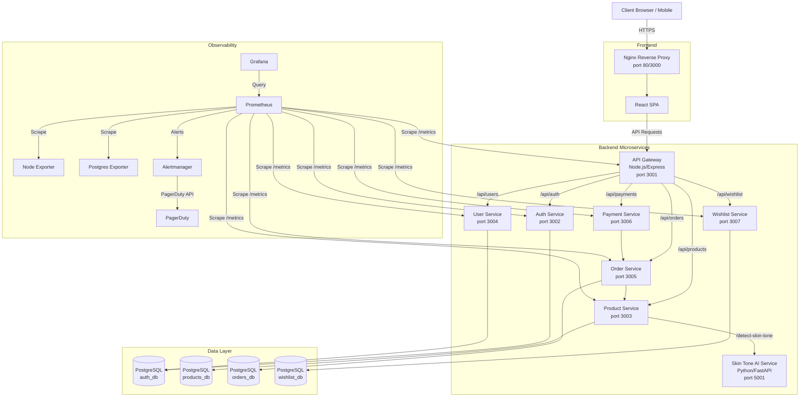
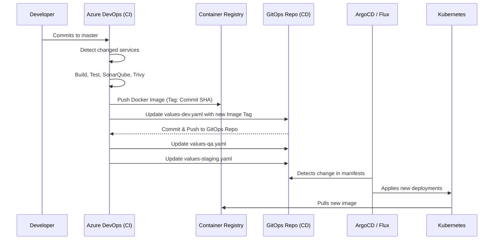
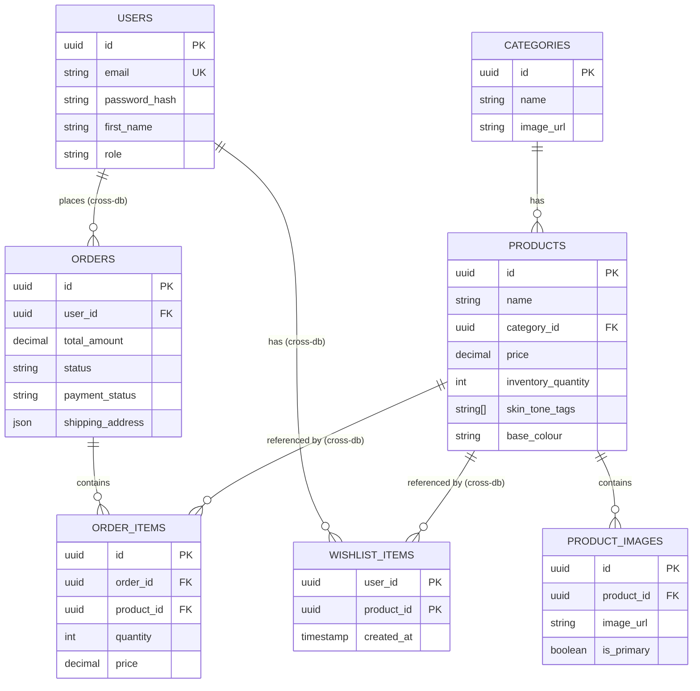

# 🛍️ Boutique Enterprise Microservices App


Welcome to the **Boutique Microservices App**, an enterprise-grade luxury e-commerce platform demonstrating modern cloud-native architecture, advanced observability, AI-driven features, and automated CI/CD with a GitOps workflow.

---

## 📑 Table of Contents

1. [Project Overview](#-project-overview)
2. [High-Level Architecture](#-high-level-architecture)
3. [System Components & Microservices](#-system-components--microservices)
    - [Frontend Architecture](#frontend-architecture)
    - [API Gateway](#api-gateway)
    - [Backend Microservices](#backend-microservices)
    - [Database Architecture](#database-architecture)
4. [Unique Features](#-unique-features)
    - [AI-Driven Skin Tone Analysis](#ai-driven-skin-tone-analysis)
5. [DevOps & Infrastructure](#-devops--infrastructure)
    - [Docker & Containerization](#docker--containerization)
    - [CI/CD Pipelines (Azure DevOps)](#cicd-pipelines-azure-devops)
    - [GitOps Workflow](#gitops-workflow)
6. [Observability & Monitoring](#-observability--monitoring)
    - [Prometheus & Alertmanager](#prometheus--alertmanager)
    - [Grafana Dashboards](#grafana-dashboards)
7. [Local Development Guide](#-local-development-guide)
    - [Prerequisites](#prerequisites)
    - [Environment Setup](#environment-setup)
    - [Running with Docker Compose](#running-with-docker-compose)
    - [Running Services Locally (npm)](#running-services-locally-npm)
8. [API Documentation Overview](#-api-documentation-overview)
9. [Database Schema](#-database-schema)
10. [Security & Authentication](#-security--authentication)
11. [License & Contributing](#-license--contributing)

---

## 🌟 Project Overview

The Boutique App is designed as a scalable, distributed e-commerce platform. It separates core business domains (Users, Products, Orders, Payments, Wishlist) into independent microservices, facilitating parallel development, independent scaling, and fault isolation. 

Beyond standard e-commerce functionality, it introduces an innovative **Skin Tone Advisor**, utilizing an AI/ML Python backend to analyze user photos and recommend matching clothing colors and complete outfits.

---

## 🏛 High-Level Architecture

The system follows a typical microservices architecture with a React SPA frontend, an API Gateway for routing and aggregation, independent backend services, and a robust observability stack.



---

## 🧩 System Components & Microservices

### Frontend Architecture

The frontend is a modern Single Page Application (SPA) built with React and TypeScript, designed for a luxury aesthetic.

- **Technology Stack**: React 18, TypeScript, Material UI (MUI), React Router DOM.
- **State Management**: React Context API (`AuthContext`, `CartContext`, `WishlistContext`, `ToastContext`).
- **Styling**: MUI's `ThemeProvider` with a custom luxury theme (deep blacks, gold accents, elegant typography using 'Playfair Display' and 'Inter').
- **Key Features**:
  - Responsive product catalog with filtering (category, price, search).
  - Detailed product views with image galleries.
  - Cart and checkout flow.
  - User authentication (Email/Password & Google OAuth).
  - User profile and order history.
  - **Skin Tone Advisor UI**: A dedicated interface for uploading a photo, receiving an AI skin tone analysis, and viewing curated outfit recommendations.

### API Gateway

- **Role**: Acts as the single entry point for all client API requests, routing them to the appropriate backend microservice.
- **Technology**: Node.js, Express, `http-proxy-middleware`.
- **Features**:
  - Centralized routing and path rewriting.
  - CORS and Helmet security headers.
  - Prometheus metrics instrumentation.

### Backend Microservices

All Node.js backend services are built with Express and TypeScript, utilizing `pg` for PostgreSQL connectivity. They share common metric instrumentation patterns.

1. **Auth Service (`/api/auth`)**:
   - Handles user registration, login (password hashing with `bcryptjs`), and Google OAuth integration.
   - Issues JWT-like tokens (or UUIDs in demo mode) for session management.
   - Interacts with the `auth_db`.

2. **User Service (`/api/users`)**:
   - Manages user profiles (first name, last name, phone, address).
   - Provides a reverse geocoding endpoint leveraging Azure Maps API to convert coordinates into addresses.
   - Shares the `auth_db` with the Auth Service.

3. **Product Service (`/api/products` & `/api/recommendations`)**:
   - Manages the product catalog, categories, and inventory.
   - Handles advanced querying (pagination, filtering by skin tone tags, sorting).
   - Orchestrates the recommendation pipeline by communicating with the Skin Tone AI service and generating outfit combinations.
   - Interacts with the `products_db`.

4. **Order Service (`/api/orders`)**:
   - Handles order creation, status updates, and retrieving order history.
   - Communicates synchronously with the Product Service to fetch current pricing and validate items during order creation.
   - Interacts with the `orders_db`.

5. **Payment Service (`/api/payments`)**:
   - Integrates with Razorpay for processing transactions.
   - Creates Razorpay orders, verifies payment signatures, and updates order statuses in the Order Service.

6. **Wishlist Service (`/api/wishlist`)**:
   - Manages user wishlists (add, remove, list).
   - Interacts with the `wishlist_db`.

7. **Skin Tone AI Service (`port 5001`)**:
   - **Technology**: Python, FastAPI, OpenCV, Scikit-learn (K-Means).
   - **Role**: Internal service that accepts image bytes, detects faces using Haar Cascades, extracts skin pixels, and performs K-Means clustering to determine the dominant skin tone.
   - Maps the detected tone to predefined color palettes and returns clothing color recommendations.

### Database Architecture

The application uses PostgreSQL 15 as the primary data store. To adhere to microservice principles, data is segregated into logical databases within the same PostgreSQL instance (for operational simplicity in this deployment).

- `auth_db`: Stores user credentials, profiles, and roles.
- `products_db`: Stores categories, products, product images, and attributes (including skin tone tags).
- `orders_db`: Stores orders, order items, shipping addresses, and payment statuses.
- `wishlist_db`: Stores user-product wishlist associations.

Data is initialized via shell scripts and SQL seed files in `database/init/`, populating a rich catalog of formal wear upon startup.

---

## ✨ Unique Features

### AI-Driven Skin Tone Analysis

A standout feature of the Boutique App is its personalized fashion advisor. 

1. **User Flow**: A user visits the "Style Advisor" page and uploads a selfie.
2. **Orchestration**: The React frontend posts the image to the Product Service (`/api/recommendations`).
3. **AI Processing**: The Product Service forwards the raw image bytes to the Python Skin Tone Service via a `multipart/form-data` internal request.
4. **Computer Vision**: 
   - OpenCV detects the face and crops the relevant region.
   - A heuristic filter isolates skin pixels from the background.
5. **Machine Learning**: 
   - K-Means clustering determines the dominant RGB color of the skin pixels.
   - The system maps this color to a predefined skin tone group (e.g., Deep, Medium, Fair).
6. **Recommendation Engine**: 
   - The Python service returns recommended colors for shirts, pants, and shoes based on the detected tone.
   - The Product Service queries the `products_db` for items matching these specific colors.
   - It assembles full outfit combinations (Topwear + Pants + Shoes) and returns them to the frontend for display.

---

## 🚀 DevOps & Infrastructure

The project embraces modern DevOps practices, utilizing containerization, comprehensive CI/CD, and GitOps for continuous delivery.

### Docker & Containerization

- Every service has its own `Dockerfile`.
- `docker-compose.yml` orchestrates the entire local stack (15+ containers), including all app services, databases, and the complete monitoring stack.
- Multi-stage builds are used where applicable to minimize image sizes.

### CI/CD Pipelines (Azure DevOps)

The repository contains an extensive Azure DevOps pipeline (`azure-pipelines.yml`) for automated testing, building, and deployment.

- **Dynamic Matrix Builds**: The `azure/templates/detect-changes.yml` script intelligently uses `git diff` against `azure/services.json` to determine exactly which microservices have changed. Only modified services are built, drastically reducing CI times.
- **Security Scanning**:
  - **SonarQube**: Static code analysis is run on changed services (`SonarQubeAnalyze@7`).
  - **Trivy**: Container images are scanned for vulnerabilities before being pushed to the registry.
- **Artifacts**: Docker images are pushed to an Azure Container Registry (ACR) (`boutiqueacrshared.azurecr.io`).

### GitOps Workflow

Continuous Deployment is handled via a GitOps model, separating CI (Build) from CD (Deploy).



- The Azure pipeline stages (`UpdateDev`, `UpdateQA`, `UpdateStaging`, `UpdateProd`) check out a separate `boutique-gitops` repository.
- A script updates the Helm `values-{env}.yaml` files with the newly built Docker image tags (the git commit SHA).
- These changes are committed and pushed back to the GitOps repository, triggering cluster synchronization tools (like ArgoCD or Flux) to deploy the new versions.

---

## 📊 Observability & Monitoring

The application includes a production-ready observability stack for deep insight into system health and performance.

### Prometheus & Alertmanager

- **Prometheus**: Configured (`prometheus.yml`) to scrape metrics every 15 seconds from all Node.js services (using `prom-client`), the `node-exporter` (host metrics), and `postgres-exporter` (database metrics).
- **Recording Rules**: Pre-computes 99th percentile request durations and 5-minute request rates for faster dashboard loading.
- **Alertmanager**: Evaluates rules (`alerts.yml`) such as `InstanceDown`, `HighErrorRate` (>5% HTTP 5xx), and `HighMemoryUsage`. Critical alerts are routed to a **PagerDuty** integration via API key.

### Grafana Dashboards

Grafana is pre-provisioned via Docker volumes with datasources and several comprehensive dashboards:

1. **Business KPIs** (`business-kpis.json`): Direct SQL queries to `orders_db` and `auth_db` showing Total Revenue, Total Orders, Total Users, and Order success/failure ratios over time.
2. **Services RED** (`services-red.json`): Rate, Errors, Duration metrics for all microservices. Includes Node.js Event Loop Lag, Heap Memory usage, and HTTP status code breakdowns.
3. **Infrastructure** (`infrastructure.json`): CPU, Memory, and Disk usage at the host and container levels.
4. **PostgreSQL Details** (`postgres.json`): Deep dive into database performance, cache hit ratios, transaction rates, and active connections.

---

## 💻 Local Development Guide

### Prerequisites

- Node.js (v18.x recommended)
- npm or yarn
- Python 3.9+ (for Skin Tone Service)
- Docker & Docker Compose
- Git

### Environment Setup

1. **Clone the repository**:
   ```bash
   git clone <repo-url> boutique-app
   cd boutique-app
   ```

2. **Configure Environment Variables**:
   Create a `.env` file in the root directory. You can copy the variables from the `docker-compose.yml` environment blocks or use the provided example below:
   
   ```env
   # .env
   RAZORPAY_KEY_ID=your_razorpay_key
   RAZORPAY_KEY_SECRET=your_razorpay_secret
   CLOUDINARY_CLOUD_NAME=your_cloudinary_name
   CLOUDINARY_API_KEY=your_cloudinary_api_key
   CLOUDINARY_API_SECRET=your_cloudinary_api_secret
   AZURE_MAPS_SUBSCRIPTION_KEY=your_azure_maps_key
   GOOGLE_CLIENT_ID=your_google_oauth_client_id
   ```

### Running with Docker Compose

The easiest way to run the entire stack locally is via Docker Compose.

1. **Build and start all services**:
   ```bash
   npm run docker:up
   # or manually: docker-compose up -d --build
   ```

2. **Accessing the Application**:
   - **Frontend**: http://localhost:3000
   - **API Gateway**: http://localhost:3001
   - **Grafana**: http://localhost:3008 (User: `admin`, Password: `admin`)
   - **Prometheus**: http://localhost:9090
   - **Alertmanager**: http://localhost:9093

3. **Stopping the stack**:
   ```bash
   npm run docker:down
   ```

### Running Services Locally (npm)

For active development, you may want to run the frontend and Node.js backend services on your host machine while relying on Docker just for PostgreSQL.

1. **Install all dependencies** (uses npm workspaces):
   ```bash
   npm run install:all
   ```

2. **Start the database via Docker**:
   ```bash
   docker-compose up -d postgres
   ```
   *Note: Ensure the database initialization scripts in `database/init/` run successfully.*

3. **Start the development servers**:
   ```bash
   npm run dev
   ```
   This uses `concurrently` to run both `npm run dev:frontend` and `npm run dev:backend`.

---

## 📖 API Documentation Overview

All API requests from the frontend pass through the API Gateway (`http://localhost:3001/api`).

- **`/api/auth`**:
  - `POST /register`: Create a new user account.
  - `POST /login`: Authenticate and receive a token (Supports a demo login with password `demo`).
  - `POST /google`: Authenticate via Google OAuth.
  - `GET /me`: Retrieve current user profile.

- **`/api/products`**:
  - `GET /`: List products with pagination (`?page=1&limit=12`), filtering (`?category=Shirts`), and search (`?search=blue`).
  - `GET /categories`: List all product categories.
  - `GET /by-skin-tone/:group`: Fetch products specifically tagged for a skin tone group.
  - `GET /:id`: Retrieve a single product by ID.

- **`/api/recommendations`**:
  - `POST /`: Upload an image (`multipart/form-data`) to receive skin tone analysis and outfit recommendations.

- **`/api/orders`**:
  - `POST /`: Create a new order.
  - `GET /my-orders`: Retrieve order history for the authenticated user.
  - `PATCH /:id/status`: Update order fulfillment status.

- **`/api/payments`**:
  - `POST /orders`: Initialize a Razorpay order.
  - `POST /verify`: Verify a successful payment signature from Razorpay.

- **`/api/users`**:
  - `GET /location/reverse`: Get an address from lat/long using Azure Maps.
  - `PUT /profile`: Update user profile details.

- **`/api/wishlist`**:
  - `GET /`: List wishlist items.
  - `POST /:productId`: Add an item to the wishlist.
  - `DELETE /:productId`: Remove an item from the wishlist.

---

## 🗄️ Database Schema

The application utilizes multiple logical databases. Here is a simplified Entity-Relationship diagram across the boundaries:



---

## 🔒 Security & Authentication

- **Authentication**: Custom JWT-based authentication (with demo mode fallback) and Google OAuth integration using `google-auth-library`.
- **Password Security**: Passwords are hashed using `bcryptjs` before storage.
- **Frontend Security**: Nginx is configured with strict security headers (`X-Frame-Options`, `X-XSS-Protection`, `Content-Security-Policy`).
- **Backend Security**: Express APIs utilize `helmet` for secure HTTP headers and `cors` for Cross-Origin Resource Sharing restrictions.
- **Payment Security**: Razorpay integration ensures sensitive payment details do not hit the application servers, utilizing server-side signature verification.

---

## 📜 License & Contributing

This project is proprietary and intended for enterprise demonstration purposes. 

When contributing, ensure you adhere to the microservices boundaries. Database access should not cross domain boundaries directly; use synchronous HTTP calls (via the API Gateway or internal DNS) or implement an asynchronous message bus (e.g., Kafka, RabbitMQ) for cross-service communication.
