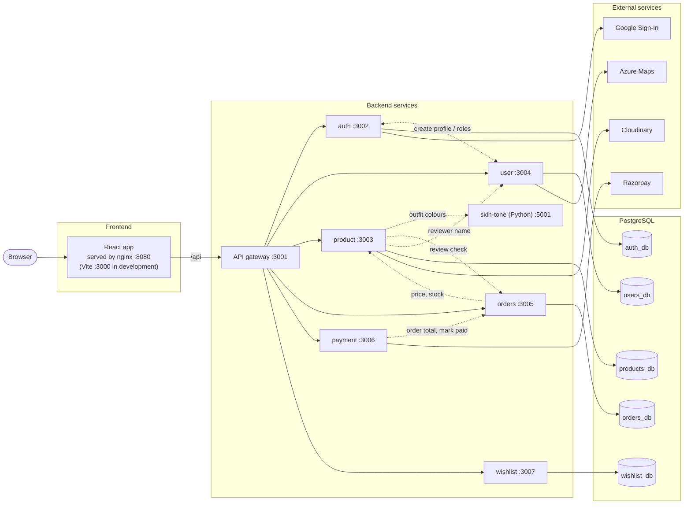
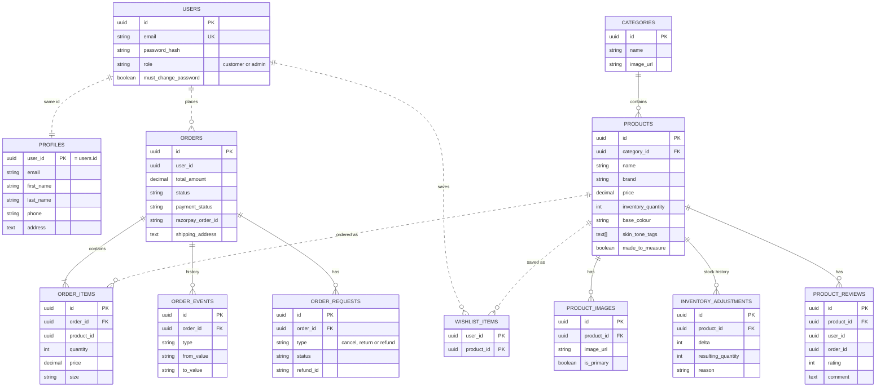

# Lux Atelier – Boutique Microservices App

An online shop for **men's formal wear** (shirts, trousers, shoes, blazers, suits and coats), built
as a set of **microservices** and deployed on **Azure Kubernetes Service (AKS)**.

## About the project

Customers can browse the catalogue, add items to a cart or wishlist, pay online, and track their
orders. The store owner gets an admin area to manage orders, products, stock and customers.

The standout feature is the **Style Advisor**: the customer uploads a selfie, a Python
computer-vision service detects their skin tone, and the shop suggests colours and complete outfits
(shirt + trousers + shoes) that are in stock.

**Main features**

- Product catalogue with search, filters and sorting
- Cart, checkout and online payment (Razorpay)
- Order history, cancellations, returns and refunds
- Sign-in with email/password or Google
- Wishlist and customer profile (address can be filled from your current location)
- Invoice PDF, generated in the browser
- Style Advisor: skin-tone detection and outfit recommendations
- Admin area: orders, refunds, products, stock, customers and KPIs

**How it is built**

- Each business area is its own service with its **own database**, so services can be built,
  deployed and scaled independently.
- The browser talks to a single **API gateway**, which routes each request to the right service.
- Services that need data from each other ask over HTTP; they never read each other's tables.

The project is split into three repositories:

| Repository | Contains |
|---|---|
| `boutique-app` (this one) | Website, microservices, database schema, local setup, CI pipeline |
| `boutique-gitops` | Helm chart that deploys the app to Kubernetes |
| `boutique-infra` | Terraform for the Azure infrastructure |

## Tech stack

| Layer | Technologies |
|---|---|
| **Frontend** | React 19, TypeScript, Vite, Material UI 7, React Router 7, Axios, jsPDF |
| **Backend services** | Node.js 26, Express, TypeScript |
| **AI service** | Python 3.12, FastAPI, OpenCV, scikit-learn (K-Means) |
| **Database** | PostgreSQL 16 (Azure Database for PostgreSQL) |
| **Authentication** | JWT (access and refresh tokens), bcrypt, Google Sign-In |
| **External services** | Razorpay (payments), Cloudinary (product images), Azure Maps (address lookup) |
| **Containers** | Docker, nginx (serves the website) |
| **Cloud and deployment** | Azure Kubernetes Service, Azure Container Registry, Azure Key Vault, Application Gateway, Helm |
| **Infrastructure as code** | Terraform |
| **CI/CD** | Azure DevOps Pipelines, SonarCloud (code quality), Trivy (image scanning) |
| **Monitoring** | Prometheus, Grafana, Alertmanager, PagerDuty |
| **Testing** | Vitest |

## Architecture

The browser loads the React app and sends every API call to `/api`. The **API gateway** forwards
each call to the right service. Every service checks the user's login token itself and works only
with its own database. Solid arrows are requests and database access; dotted arrows are internal
calls between services.

## Database schema

One PostgreSQL server holds **five databases, one per service**. Solid lines are real foreign keys
inside a database. Dotted lines link records across databases by id only; the services resolve
those links over HTTP.

| Database | Owned by | Tables |
|---|---|---|
| `auth_db` | auth | `users` (email, password hash, role) |
| `users_db` | user | `profiles` (name, phone, address) |
| `products_db` | product | `categories`, `products`, `product_images`, `inventory_adjustments`, `product_reviews` |
| `orders_db` | orders | `orders`, `order_items`, `order_events`, `order_requests` |
| `wishlist_db` | wishlist | `wishlist_items` |

The full schema is in [database/init/20-init-schema.sql](database/init/20-init-schema.sql).
