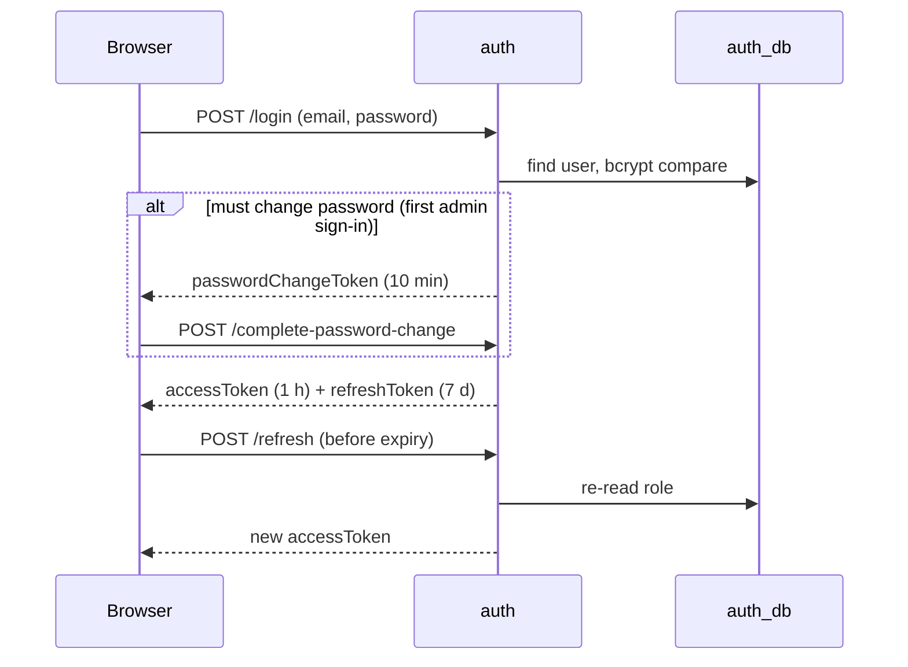

# auth

**Sign-up, sign-in and tokens.** Email/password and Google sign-in, JWT access and refresh tokens,
the forced password change for the store admin. Node.js + Express + PostgreSQL (`auth_db`). Port **3002**.

`auth_db` holds only the account: email, password hash and role. Names, phone and address
belong to the user service; when auth creates an account it sends the name to the user service.



## Routes

Reached through the gateway as `/api/auth/...`.

| Method | Path | Access | What it does |
|---|---|---|---|
| POST | `/register` | public | Create a customer account (email validated, password min length) |
| POST | `/login` | public | Email + password → tokens (or a password-change token) |
| POST | `/google` | public | Google ID token → tokens. Creates the account on first use |
| POST | `/refresh` | refresh token | New access token. The role is re-read from the database |
| POST | `/logout` | public | Acknowledges sign-out. Tokens are dropped by the client |
| POST | `/complete-password-change` | password-change token | Set the new password (12+ chars, not the initial one) and get a session |
| POST | `/change-password` | signed in | Change your own password |
| GET | `/me` | signed in | Current account (id, email, role) |
| GET | `/internal/accounts/roles?ids=` | internal token | Roles for a list of user ids, and the admin count |
| GET | `/health`, `/metrics` | — | Liveness, Prometheus |

With `DEMO_LOGIN_ENABLED=true` (local only, refused in production), `routes/auth.ts` also
lets you sign in with the password `demo`. It only ever creates new demo customers.

## Store admin bootstrap

On start, [`src/bootstrap.ts`](src/bootstrap.ts) creates `ADMIN_EMAIL` with `ADMIN_INITIAL_PASSWORD`
and a *must change password* flag, but **only if the account doesn't exist**. Restarts and redeploys never
reset it. If the password is shorter than 12 characters, the admin is not created. When the admin is created, its
profile ("Store Admin") is sent to the user service; start the user service first so this succeeds. To grant more admins,
use [`database/scripts/grant-admin.sql`](../../../database/scripts/grant-admin.sql).

## Environment

| Variable | Required | Notes |
|---|---|---|
| `DATABASE_URL` | yes | `postgresql://.../auth_db` |
| `USER_SERVICE_URL` | yes | e.g. `http://user-service:3004` |
| `INTERNAL_API_TOKEN` | yes | Shared token for service-to-service calls |
| `JWT_SECRET` | yes | Shared by every service that verifies tokens. The service refuses to start in production without it |
| `GOOGLE_CLIENT_ID` | yes | Google sign-in audience |
| `ADMIN_EMAIL` | no | Default `admin@luxatelier.in` |
| `ADMIN_INITIAL_PASSWORD` | yes | 12+ characters |
| `JWT_EXPIRES_IN` / `JWT_REFRESH_EXPIRES_IN` | no | Default `1h` / `7d` |
| `DB_SSL` | no | `require` on Azure PostgreSQL |
| `PORT`, `NODE_ENV`, `LOG_LEVEL` | no | |

## Files

`src/routes/auth.ts` (routes), `src/bootstrap.ts` (admin), `src/validation.ts` (email/phone/password
rules), `src/metrics/`. `requireUser` / `requireAdmin` / `requireInternal` come from the shared
package [`backend/shared`](../../shared).

## Run and test

```bash
npm install
npm run dev
npm test           # bootstrap.test.ts, routes/auth.test.ts
```
