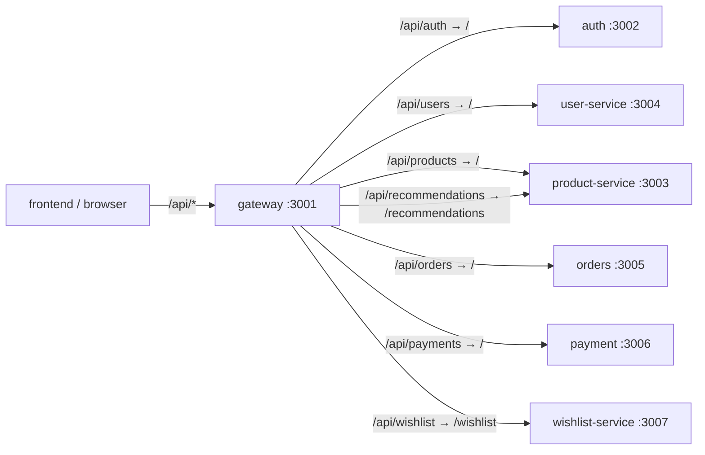

# gateway

**The single entry point for the API.** The browser calls `/api/...`, and the gateway forwards
each request to the right service. Node.js + Express + `http-proxy-middleware`. Port **3001**.



## Routes

| Incoming path | Forwarded to | Path rewrite |
|---|---|---|
| `/api/auth/*` | `AUTH_SERVICE_URL` | prefix removed |
| `/api/users/*` | `USER_SERVICE_URL` | prefix removed |
| `/api/products/*` | `PRODUCTS_SERVICE_URL` | prefix removed |
| `/api/recommendations/*` | `PRODUCTS_SERVICE_URL` | → `/recommendations` |
| `/api/orders/*` | `ORDERS_SERVICE_URL` | prefix removed |
| `/api/payments/*` | `PAYMENTS_SERVICE_URL` | prefix removed |
| `/api/wishlist/*` | `WISHLIST_SERVICE_URL` | → `/wishlist` |
| `GET /`, `GET /api` | the gateway itself | service info |
| `GET /health`, `GET /metrics` | the gateway itself | liveness and Prometheus metrics |

Anything else returns 404.

## What it adds

- **Security headers** with `helmet`.
- **CORS allow-list** from `CORS_ORIGINS` (comma-separated). Only the shop's own origin may call the
  API from a browser.
- **Strips `x-internal-token`** from every client request, so a browser can never pretend to be a
  service. Internal calls go directly between services and never through the gateway.
- **Metrics** per route template (request count, duration histogram, status codes).

The gateway does **not** check JWTs. Each service verifies them itself.

## Environment

| Variable | Example (Docker Compose) |
|---|---|
| `PORT` | `3001` |
| `NODE_ENV` | `development` / `production` |
| `CORS_ORIGINS` | `http://localhost:3000` (AKS: the environment host, e.g. `https://bq-dev-boutique.uaenorth.cloudapp.azure.com`) |
| `AUTH_SERVICE_URL` | `http://auth:3002` |
| `USER_SERVICE_URL` | `http://user-service:3004` (Kubernetes: `http://user:3004`) |
| `PRODUCTS_SERVICE_URL` | `http://product-service:3003` |
| `ORDERS_SERVICE_URL` | `http://orders:3005` |
| `PAYMENTS_SERVICE_URL` | `http://payment:3006` |
| `WISHLIST_SERVICE_URL` | `http://wishlist-service:3007` (Kubernetes: `http://wishlist:3007`) |

## Run

```bash
npm install
npm run dev        # ts watch mode
npm run build && npm start
```

There are no unit tests. To check it end to end, run `curl http://localhost:3001/api/products`.
