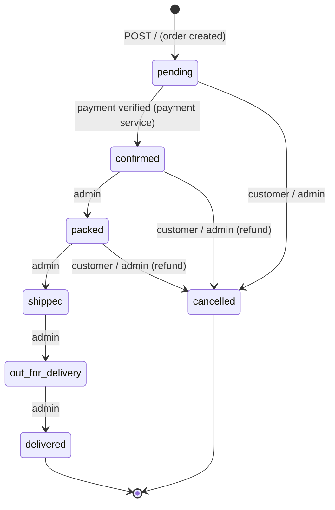

# orders

**Orders, pricing and fulfilment.** Creates orders with server-side prices, moves them through
fulfilment, and handles cancellations, returns and refunds, plus the admin order screens and KPIs.
Node.js + Express + PostgreSQL (`orders_db`). Port **3005**.



Payment status is tracked separately: `pending → paid → refunded`, or `failed`. Fulfilment moves
**one step at a time and only once paid**, and an order can be cancelled until it ships. The rules
are pure functions in [`src/lifecycle.ts`](src/lifecycle.ts).

## Pricing

[`src/pricing.ts`](src/pricing.ts): the client never sends amounts. Prices come from product-service.
Shipping is ₹15 up to ₹500 and free above, plus 8% tax.

## Routes

| Method | Path | Access | What it does |
|---|---|---|---|
| POST | `/` | signed in | Create an order (items, address) |
| GET | `/my-orders` | signed in | Your orders |
| POST | `/:id/cancel` | signed in | Cancel before shipping |
| POST | `/:id/return` | signed in | Request a return or refund (type + reason). An admin approves it with a refund or rejects it |
| PATCH | `/:id/status` | admin | Next fulfilment step |
| PATCH | `/:id/payment-status` | internal token | Set by the payment service |
| GET | `/admin/orders`, `/admin/orders/:id` | admin | Order list and detail (with events) |
| PATCH | `/admin/orders/:id/status` | admin | Fulfilment step |
| POST | `/admin/orders/:id/refund` | admin | Refund a cancelled or returned order |
| POST | `/admin/orders/:id/requests/:requestId/reject` | admin | Reject a customer request |
| GET | `/admin/customers/summary`, `/admin/kpis` | admin | Dashboard numbers |
| GET | `/internal/orders/:id` | internal token | Order for the payment service |
| PUT | `/internal/orders/:id/razorpay-order` | internal token | Bind the Razorpay order id |
| GET | `/internal/orders/:id/review-eligibility` | internal token | Whether a user may review items (delivered order) |
| GET | `/health`, `/metrics` | — | |

Every change is recorded in `order_events`.

## Environment

| Variable | Required | Notes |
|---|---|---|
| `DATABASE_URL` | yes | `orders_db` |
| `JWT_SECRET`, `INTERNAL_API_TOKEN` | yes | |
| `PRODUCTS_SERVICE_URL` | yes | Prices and stock |
| `DB_SSL` | no | `require` on Azure PostgreSQL |

## Run and test

```bash
npm install
npm run dev
npm test           # lifecycle.test.ts, pricing.test.ts, routes/routes.test.ts
```
