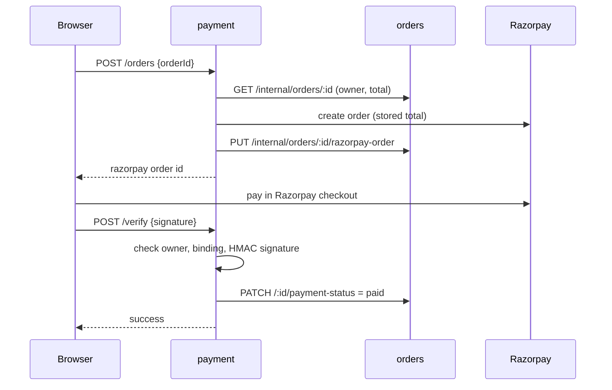

# payment

**Razorpay checkout and refunds.** Creates the Razorpay order for the stored total, verifies the
payment signature, marks the order paid, and issues admin refunds. Node.js + Express. It has no
database of its own and asks the orders service for everything. Port **3006**.



**Invoices are not generated here.** The frontend builds the PDF in the browser with `jsPDF`
([`frontend/src/services/invoice/invoicePdfService.ts`](../../../frontend/src/services/invoice/invoicePdfService.ts))
from the order data. No invoice email is sent. (luxatelier-app instead generates the PDF in
this service and emails it through S3/SQS/SES.)

## Routes

| Method | Path | Access | What it does |
|---|---|---|---|
| POST | `/orders` | signed in (owner) | Create the Razorpay order |
| POST | `/verify` | signed in (owner) | Verify the signature, mark the order paid |
| POST | `/status` | signed in (owner) | Report a failed checkout attempt (refunds are admin-only) |
| POST | `/admin/orders/:id/refund` | admin | Full Razorpay refund of a paid order, then orders marks it `refunded`. Safe to retry: an already-issued refund is not repeated |
| GET | `/health`, `/metrics` | — | |

## Environment

| Variable | Required | Notes |
|---|---|---|
| `RAZORPAY_KEY_ID`, `RAZORPAY_KEY_SECRET` | yes | Test keys locally. In AKS they come from Key Vault through External Secrets |
| `JWT_SECRET`, `INTERNAL_API_TOKEN` | yes | |
| `ORDERS_SERVICE_URL` | yes | |

## Run and test

```bash
npm install
npm run build && npm start
npm test           # services/paymentService.test.ts
```
