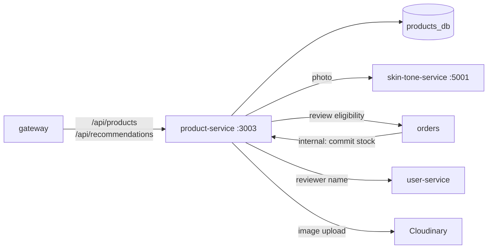

# product-service

**Catalogue, stock, reviews and the Style Advisor.** Products and categories, the admin catalogue
and inventory, product images on Cloudinary, customer reviews, and the recommendation pipeline that
calls the skin-tone service. Node.js + Express + PostgreSQL (`products_db`). Port **3003**.



## Style Advisor flow (`POST /recommendations`)

1. The browser uploads a photo (`multipart/form-data`, field `image`, max 20 MB).
2. The photo is forwarded to `SKIN_TONE_SERVICE_URL/detect-skin-tone`.
3. The skin-tone service returns the tone group and recommended shirt, trouser and shoe colours.
4. The service queries `products_db` for in-stock items in those colours and builds outfits
   (top + trousers + shoes), then returns tone, palette and outfits.

## Routes

| Method | Path | Access | What it does |
|---|---|---|---|
| GET | `/` | public | Products with `page`, `limit`, `category`, `search`, `minPrice`, `maxPrice`, `sortBy`, `sortOrder`, `handcrafted` |
| GET | `/categories` | public | Categories |
| GET | `/by-skin-tone/:group` | public | Products tagged for a tone group |
| GET | `/:id` | public | One product with images |
| POST | `/recommendations` | public | Style Advisor (see above) |
| GET | `/reviews/product/:productId` | public | Reviews of a product |
| GET | `/reviews/mine` | signed in | Your reviews |
| POST | `/reviews` | signed in | Review an item from a **delivered** order (checked with orders) |
| GET | `/admin/categories`, `/admin/products`, `/admin/products/:id` | admin | Admin catalogue |
| POST / PUT | `/admin/products`, `/admin/products/:id` | admin | Create / edit a product |
| PATCH | `/admin/products/:id/status` | admin | Publish / hide |
| POST | `/admin/products/:id/image` | admin | Upload image to Cloudinary |
| POST | `/admin/products/:id/inventory` | admin | Adjust stock (recorded in `inventory_adjustments`) |
| GET | `/admin/products/:id/inventory-history`, `/admin/inventory/summary` | admin | Stock history and summary |
| POST | `/internal/inventory/commit` | internal token | Deduct or return stock when an order is paid, cancelled or refunded |
| GET | `/health`, `/metrics` | — | |

## Environment

| Variable | Required | Notes |
|---|---|---|
| `DATABASE_URL` | yes | `products_db` |
| `JWT_SECRET`, `INTERNAL_API_TOKEN` | yes | |
| `CLOUDINARY_CLOUD_NAME`, `CLOUDINARY_API_KEY`, `CLOUDINARY_API_SECRET` | yes | |
| `SKIN_TONE_SERVICE_URL` | no | Default `http://localhost:5001` |
| `ORDERS_SERVICE_URL`, `USER_SERVICE_URL` | yes | For review checks and reviewer names |
| `DB_SSL` | no | `require` on Azure PostgreSQL |

## Run and test

```bash
npm install
npm run dev
npm test               # routes/routes.test.ts
```
