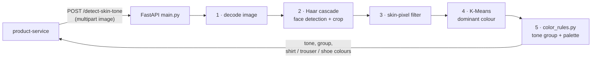

# skin-tone-service

**The AI behind the Style Advisor.** Takes a photo, finds the face, measures the dominant skin
colour and returns a tone group with recommended clothing colours. Python 3.12 + FastAPI + OpenCV +
scikit-learn. Port **5001**. It is internal only, and only product-service calls it.



## Files

| File | Role |
|---|---|
| [`main.py`](main.py) | FastAPI app: `/detect-skin-tone`, `/health`, `/metrics` |
| [`skin_tone_analyzer.py`](skin_tone_analyzer.py) | Face detection, skin mask, K-Means clustering |
| [`color_rules.py`](color_rules.py) | Tone table (e.g. `deep`, `medium_dark`, ...) → recommended colours per garment |
| [`metrics.py`](metrics.py) | Prometheus middleware with the same label conventions as the Node services (route template, method, status) |

## API

| Method | Path | Body | Returns |
|---|---|---|---|
| POST | `/detect-skin-tone` | `multipart/form-data`, field `image` (max 20 MB) | Tone name, label, group, RGB/hex, recommended colours |
| GET | `/health` | — | `{"status": "ok", "service": "skin-tone-fastapi"}` |
| GET | `/metrics` | — | Prometheus text |

An empty or oversized file returns 400, and a photo with no detectable face returns 422. The Style Advisor shows the `detail` message to the user.

## Run

```bash
python3.12 -m venv .venv && . .venv/bin/activate
pip install -r requirements.txt
uvicorn main:app --host 0.0.0.0 --port 5001
curl -F "image=@selfie.jpg" http://localhost:5001/detect-skin-tone
```

Memory: OpenCV and scikit-learn need about 1 GiB. The Helm chart in `boutique-gitops` requests 1 GiB with a 2 GiB limit.
