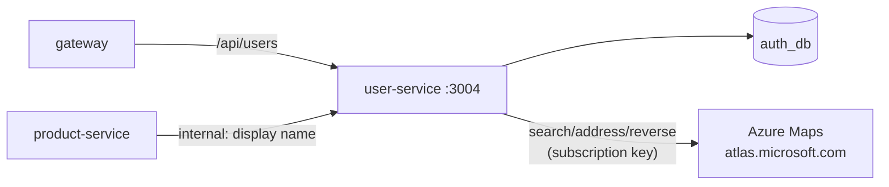

# user-service

**Customer profiles, the admin customer list, and "use my current location"** (reverse geocoding
with Azure Maps). Node.js + Express + PostgreSQL. It shares `auth_db` with the auth service. Port
**3004**. In Kubernetes the Service is called `user`.



## Routes

| Method | Path | Access | What it does |
|---|---|---|---|
| GET | `/location/reverse?lat=&lng=` | signed in | Coordinates → address (house number, street, city, state, postcode). 8 s timeout, 502 if Azure Maps fails |
| PUT | `/profile` | signed in | Update name, phone, saved address |
| GET | `/admin/customers` | admin | Paged customer list |
| GET | `/admin/customers/lookup` | admin | Names/emails for up to 100 user ids (`?ids=a,b,c`) |
| GET | `/internal/users/:id/display-name` | internal token | Reviewer name for product reviews |
| GET | `/health`, `/metrics` | — | |

`/location/reverse` is for signed-in users only, because every call spends the Azure Maps
subscription.

## Environment

| Variable | Required | Notes |
|---|---|---|
| `DATABASE_URL` | yes | `auth_db` |
| `JWT_SECRET`, `INTERNAL_API_TOKEN` | yes | |
| `AZURE_MAPS_SUBSCRIPTION_KEY` | yes | Compose refuses to start without it. In AKS it comes from Key Vault |
| `DB_SSL` | no | `require` on Azure PostgreSQL |

## Run and test

```bash
npm install
npm run build && npm start
npm test           # app.test.ts
```
