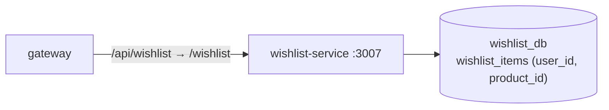

# wishlist-service

**Saved items.** Add, remove and list products on the signed-in user's wishlist. Node.js + Express
+ PostgreSQL (`wishlist_db`). Port **3007**. In Kubernetes the Service is called `wishlist`.



## Routes

| Method | Path | Access | What it does |
|---|---|---|---|
| GET | `/wishlist` | signed in | Your saved product ids |
| POST | `/wishlist/:productId` | signed in | Save (idempotent) |
| DELETE | `/wishlist/:productId` | signed in | Remove |
| GET | `/health`, `/metrics` | — | |

The service stores only ids. The frontend loads product details from product-service.

## Environment

| Variable | Required | Notes |
|---|---|---|
| `DATABASE_URL` | yes | `wishlist_db` |
| `JWT_SECRET` | yes | |
| `DB_SSL` | no | `require` on Azure PostgreSQL |
| `PORT`, `NODE_ENV` | no | |

## Run

```bash
npm install
npm run build && npm start
```

No unit tests. To check it, run `curl -H "Authorization: Bearer <token>" http://localhost:3007/wishlist`.
