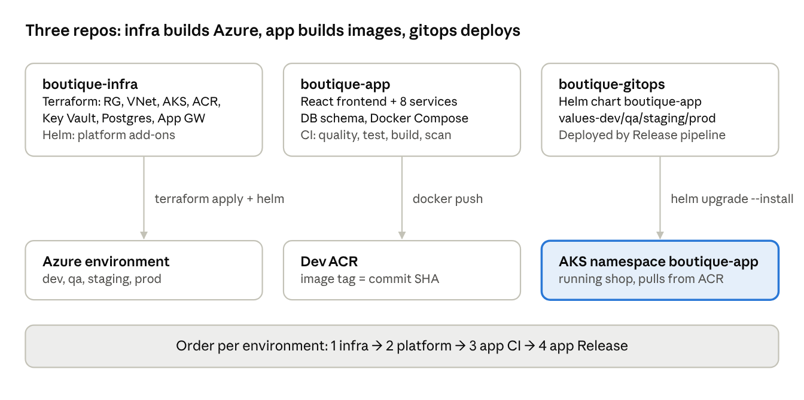
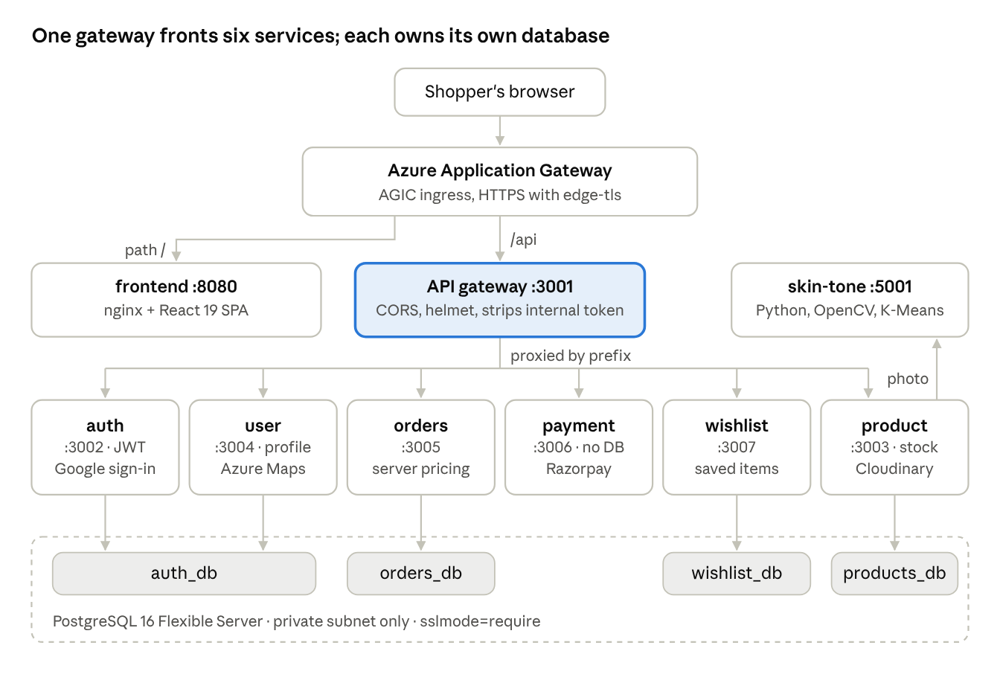
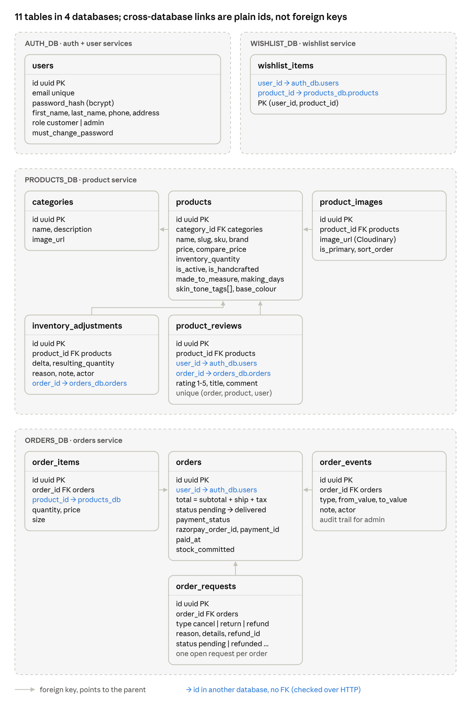
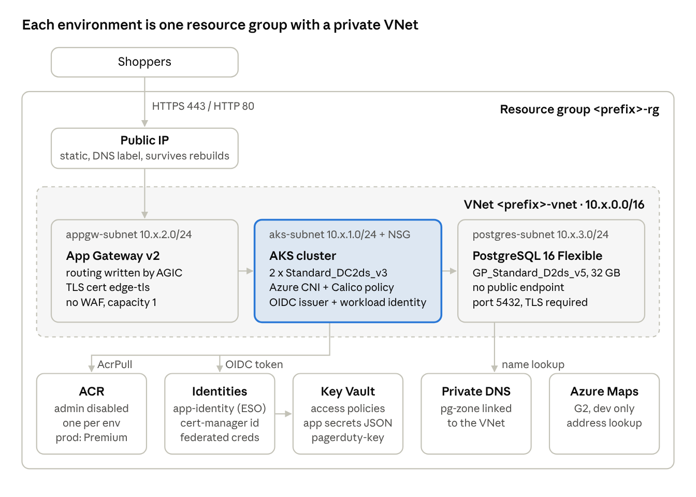
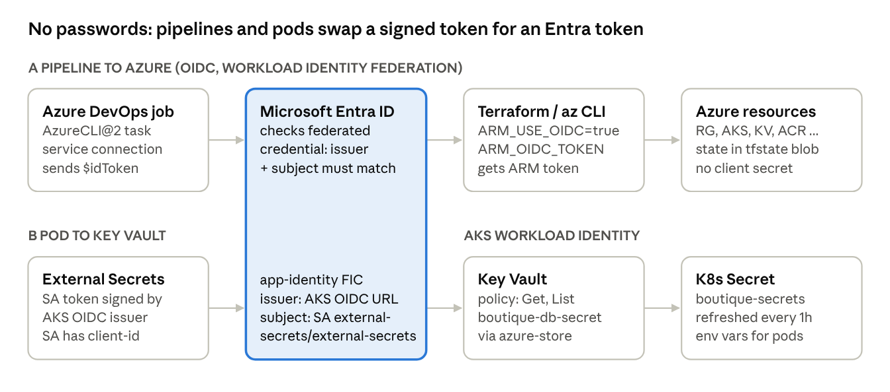
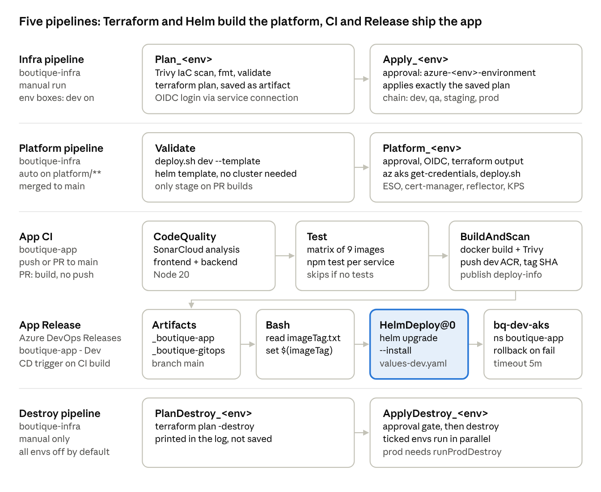
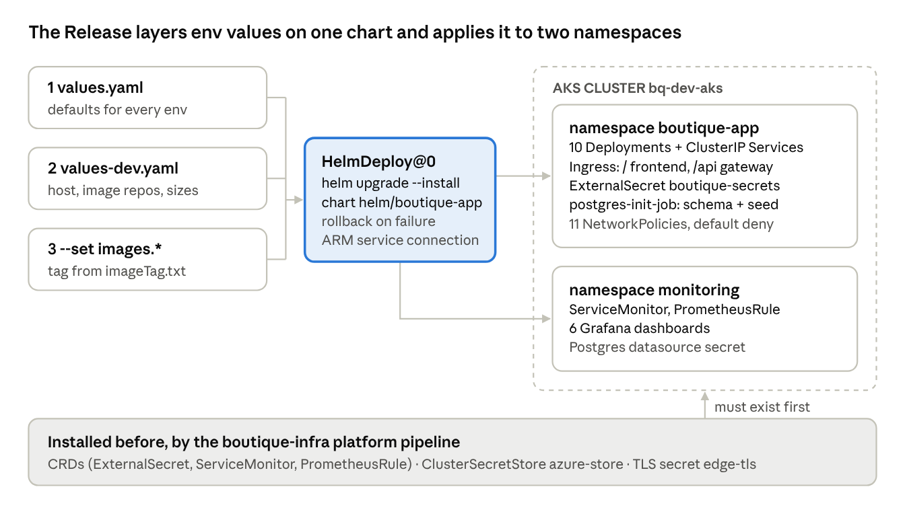
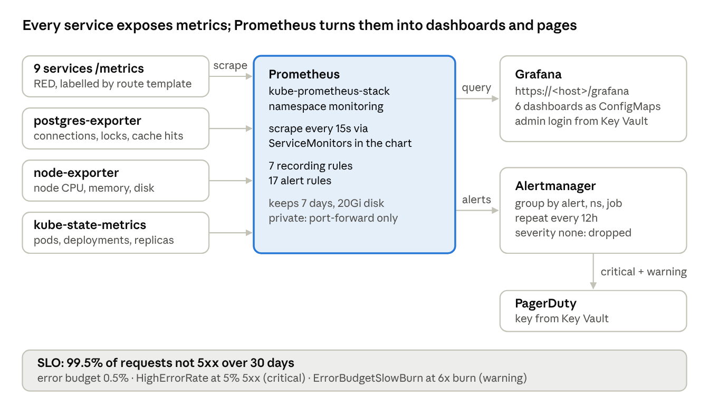

# Boutique Platform — Architecture & DevOps Overview

Sep 28, 2026 · Vinayak Nishad

## 1. The three repositories

Boutique is an online men's formal-wear shop (brand Lux Atelier) on Azure Kubernetes Service, split into three Azure DevOps repos. Infra builds the ground, app builds the images, gitops deploys them.

Everything is created by pipelines, never by clicking in the portal. Only dev runs by default; qa, staging and prod are opt-in at queue time.

## 2. Application architecture

The browser only talks to one host. App Gateway sends `/` to the React site and `/api` to the gateway, which proxies to six Node.js services. Each service checks the JWT itself.

| Internal call (direct, `x-internal-token`) | Why |
| --- | --- |
| orders → product | price and stock at order time, commit stock |
| payment → orders | order owner and total, mark paid or refunded |
| product → orders | only buyers with a delivered order may review |
| product → user | reviewer display name |
| product → skin-tone | Style Advisor: selfie → skin tone → outfit colours |

## 3. Database schema

One PostgreSQL 16 server holds four logical databases, one per domain. A service never reads another service's tables; it asks that service over HTTP.

The schema lives in `boutique-app/database/init/20-init-schema.sql`. In AKS, `postgres-init-job` runs the same SQL from a ConfigMap in boutique-gitops, so the two copies must be kept in sync. All primary keys are UUIDs (`gen_random_uuid()`).

## 4. Azure infrastructure

Terraform in `boutique-infra` builds each environment as one resource group. Only App Gateway is public; AKS and PostgreSQL sit in private subnets.

|  | dev | qa | staging | prod |
| --- | --- | --- | --- | --- |
| Prefix | bq-dev | bq-qa | bq-staging | boutique-prod |
| Region | UAE North | Central India | Central India | Central India |
| VNet | 10.1.0.0/16 | 10.3.0.0/16 | 10.4.0.0/16 | 10.2.0.0/16 |
| ACR SKU | Standard | Standard | Standard | Premium |
| Runs by default | yes | opt-in | opt-in | opt-in |

Terraform state lives in storage account `boutiquetfstate2026v2` (container `tfstate`), one blob per environment.

## 5. Identity: OIDC and Workload Identity

No client secret or password is stored anywhere for Azure access. Both flows trade a short-lived signed token for an Entra ID token, and Entra only accepts it if the issuer and subject match a federated credential.

App pods never call Key Vault; they only read the Kubernetes Secret that External Secrets writes.

| Identity | Type | Can do |
| --- | --- | --- |
| Service connection `Azure Resource Group` | federated (OIDC) | Terraform, `az aks get-credentials` |
| `<prefix>-app-identity` | user-assigned, workload identity | External Secrets reads Key Vault (Get, List) |
| `<prefix>-cert-manager-identity` | user-assigned, workload identity | no roles yet (kept for DNS-01) |
| AKS kubelet identity | created by AKS | `AcrPull` on its own environment's ACR |
| AGIC identity | AKS add-on | writes App Gateway routes (Contributor, Reader, Network Contributor) |

## 6. CI/CD pipelines

There are four YAML pipelines and one Release pipeline. A merge to `main` in boutique-app runs CI, and its build artifact triggers the Dev Release automatically.

All of them run on Microsoft-hosted `ubuntu-latest` agents and log in with the same OIDC service connection. The Release pipeline is set up in the Azure DevOps UI (Pipelines → Releases), so it is not stored as YAML in any repo. Higher environments get images through `az acr import`: images are promoted, never rebuilt.

## 7. Deployment with boutique-gitops and Releases

boutique-gitops holds the Helm chart and one values file per environment. Nothing watches the repo; a change goes live on the next Release run.

- **Rollback:** `--rollback-on-failure` undoes an upgrade that is not healthy within 5 minutes; `helm rollback` works by hand.
- **Deployed today:** dev only. QA, staging and prod have Terraform and values files but no Release pipeline yet.
- **Network:** `default-deny-all`, then each service accepts traffic only from its callers (for example orders accepts gateway, payment and product).

## 8. Monitoring and alerting

The platform pipeline installs kube-prometheus-stack; the gitops chart adds the scrape targets, rules and dashboards, so monitoring is all code.

| Alert group | Examples | Severity |
| --- | --- | --- |
| Availability | InstanceDown, ServiceScaledToZero, HighErrorRate | critical |
| Database | PostgresDown | critical |
| Latency | p95 over 1s, skin-tone p95 over 15s | warning |
| Runtime | restart loops, event-loop lag, DB pool exhausted | warning |
| Database health | too many connections, deadlocks, long transactions | warning |
| Business | payment verification rate under 50% | warning |

In this setup the default route is PagerDuty, so warnings page too, not just critical alerts. Dashboards: Microservices RED, SLOs & Error Budget, Service Runtime, Infrastructure, PostgreSQL, Business KPIs.

## 9. Summary: the story in one line per slide

1. **Repos:** three repos split the work: code, cloud and deployment are changed and reviewed separately.
2. **App:** a React site and 8 services behind one gateway, with prices computed on the server.
3. **Data:** 4 databases, one per domain, linked only by ids and HTTP calls.
4. **Azure:** everything is Terraform; only App Gateway is public, Postgres has no public endpoint.
5. **Identity:** no stored secrets for Azure access; OIDC for pipelines, workload identity for pods.
6. **Pipelines:** plan is saved and applied exactly; approvals sit on Azure DevOps environments; images are scanned with Trivy.
7. **Deploy:** a merge to main builds, pushes and releases to dev automatically, with rollback on failure.
8. **Monitoring:** Prometheus scrapes every service, Grafana dashboards are code, and alerts page PagerDuty against a 99.5% SLO.

Open gaps worth saying out loud: QA, staging and prod have no Release pipeline yet, Trivy and `terraform fmt` never fail a build, and all environments share one set of pipeline variables.
